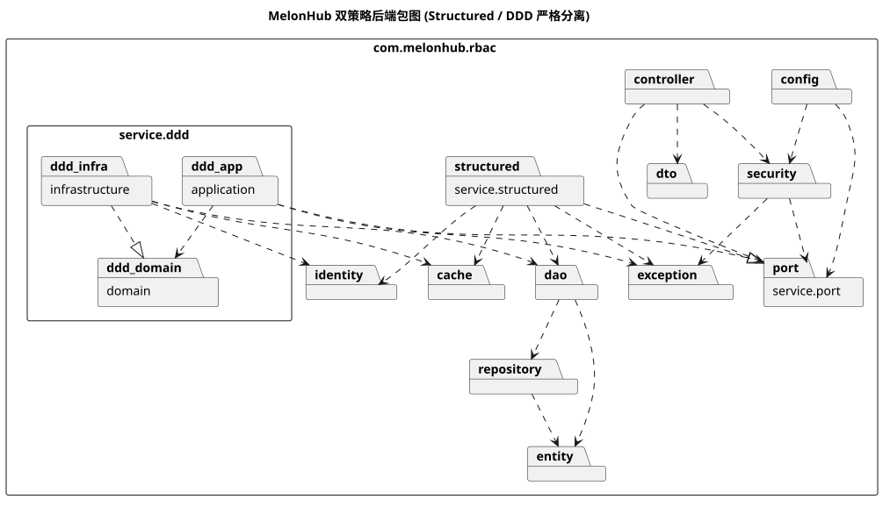
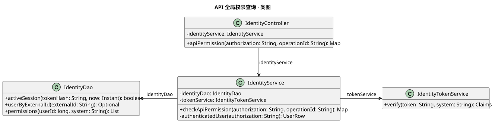
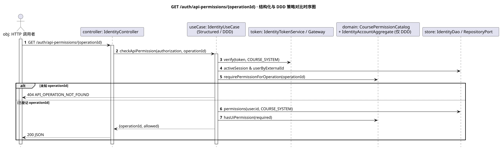
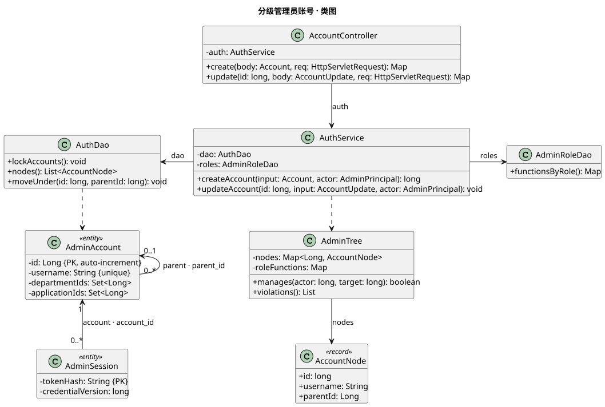
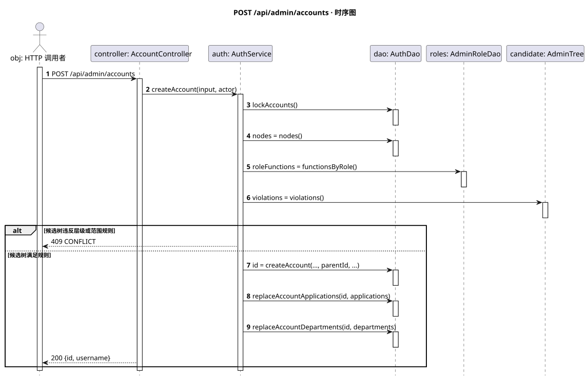

# MelonHub 后端 UML 与代码导读

本页展示 MelonHub 当前源码的包依赖与两个实际 API。权限查询展示按请求流程组织职责的设计，分级管理员展示将层级约束封装在领域对象中的做法。

## 后端包图

主入口集中在 `controller`，管理与授权用例分布在 `service`、`identity`。持久化经 `dao` 访问 `repository` 与 `entity`，鉴权、限流和请求日志集中于边界。图中保留主要依赖，模块细节见 [工程分层](ARCHITECTURE.md#10-工程分层)。

## 查询接入系统 API 权限

`GET /auth/api-permissions/{operationId}` 验证统一身份令牌和会话，再按操作标识查权限码。已登记的操作返回 `allowed`，未登记的操作返回 404，无效令牌返回 401。

源码顺序为 [IdentityController](../backend/src/main/java/com/melonhub/rbac/controller/IdentityController.java#L133)、[IdentityService](../backend/src/main/java/com/melonhub/rbac/identity/IdentityService.java#L222)、[IdentityDao](../backend/src/main/java/com/melonhub/rbac/dao/IdentityDao.java)。

## 创建分级管理员

`POST /api/admin/accounts` 需要管理员账号管理功能。时序图从控制器进入后的主流程开始，校验目标上级和候选管理员树后写入账户及管理范围。候选树的约束失败以 409 返回。领域规则位于 `AdminTree`，事务与审计由 `AuthService` 编排。

源码顺序为 [AccountController](../backend/src/main/java/com/melonhub/rbac/controller/AccountController.java)、[AuthService](../backend/src/main/java/com/melonhub/rbac/service/AuthService.java#L296)、[AdminTree](../backend/src/main/java/com/melonhub/rbac/service/AdminTree.java)。

## 图源与重绘

`doc/uml/` 保留 PlantUML 源文件和 SVG、PNG。使用 PlantUML 读取 UTF-8 源码，分别以 `-tsvg` 和 `-tpng` 输出。两种格式由同一来源生成。
