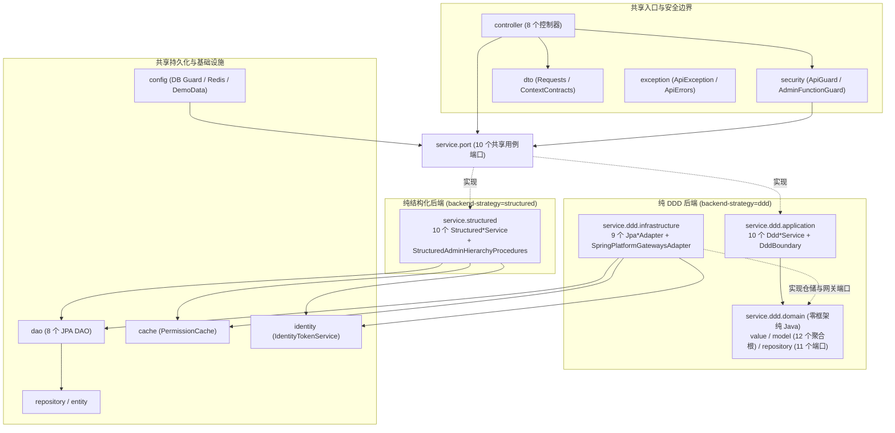

# MelonHub 后端 UML 与代码导读

本页展示 MelonHub 当前**单模块双策略后端**（`melonhub.backend-strategy=structured|ddd`）的包依赖，以及两个核心 API 在**纯结构化后端**与**纯 DDD 后端**下的完整结构与调用链路。

## 后端包图（Structured / DDD 严格分离）

主入口集中在 `controller`，全部控制器、鉴权过滤器与演示数据初始化仅依赖 `service.port`。结构化后端 `service.structured` 与 DDD 后端 `service.ddd` 互不引用；`service.ddd.domain` 为 100% 零框架纯 Java。四条架构边界由 [ArchitectureBoundaryUnitTest](../backend/src/test/java/com/melonhub/rbac/requirements/nfr_reliability/ArchitectureBoundaryUnitTest.java) 自动守护，完整包说明见 [工程分层](ARCHITECTURE.md#10-工程分层与双策略后端structured--ddd)。

## 用例一：查询接入系统 API 权限（`GET /auth/api-permissions/{operationId}`）

`GET /auth/api-permissions/{operationId}` 验证统一身份令牌和会话，再按操作标识查权限码。已登记的操作返回 `allowed`，未登记的操作返回 `404 API_OPERATION_NOT_FOUND`，无效令牌返回 `401`。

- **纯结构化路径**：[IdentityController](../backend/src/main/java/com/melonhub/rbac/controller/IdentityController.java#L164-L170) → [IdentityUseCase](../backend/src/main/java/com/melonhub/rbac/service/port/IdentityUseCase.java) → [StructuredIdentityService](../backend/src/main/java/com/melonhub/rbac/service/structured/StructuredIdentityService.java#L268-L278)（过程式串行验签、查库、映射判断）→ [IdentityDao](../backend/src/main/java/com/melonhub/rbac/dao/IdentityDao.java)。
- **纯 DDD 路径**：[IdentityController](../backend/src/main/java/com/melonhub/rbac/controller/IdentityController.java#L164-L170) → [DddIdentityService](../backend/src/main/java/com/melonhub/rbac/service/ddd/application/DddIdentityService.java#L165-L176) → [CoursePermissionCatalog](../backend/src/main/java/com/melonhub/rbac/service/ddd/domain/value/CoursePermissionCatalog.java) + [IdentityAccountAggregate](../backend/src/main/java/com/melonhub/rbac/service/ddd/domain/model/IdentityAccountAggregate.java) → 经 [IdentityRepositoryPort](../backend/src/main/java/com/melonhub/rbac/service/ddd/domain/repository/IdentityRepositoryPort.java) 与 [JpaIdentityRepositoryAdapter](../backend/src/main/java/com/melonhub/rbac/service/ddd/infrastructure/JpaIdentityRepositoryAdapter.java) 隔离持久化。

## 用例二：创建分级管理员（`POST /api/admin/accounts`）

`POST /api/admin/accounts` 锁定全部管理员账号行，校验操作者是否有权在目标上级下创建账号、范围是否越界、候选层级是否成环或违背部门管理员叶子约束；不合法以 `409 CONFLICT` 拒绝且不落库。

- **纯结构化路径**：[AccountController](../backend/src/main/java/com/melonhub/rbac/controller/AccountController.java#L31-L34) → [AuthUseCase](../backend/src/main/java/com/melonhub/rbac/service/port/AuthUseCase.java) → [StructuredAuthService](../backend/src/main/java/com/melonhub/rbac/service/structured/StructuredAuthService.java#L302-L328) → 静态无状态过程集 [StructuredAdminHierarchyProcedures](../backend/src/main/java/com/melonhub/rbac/service/structured/StructuredAdminHierarchyProcedures.java) → [AuthDao](../backend/src/main/java/com/melonhub/rbac/dao/AuthDao.java)。
- **纯 DDD 路径**：[AccountController](../backend/src/main/java/com/melonhub/rbac/controller/AccountController.java#L31-L34) → [DddAuthService](../backend/src/main/java/com/melonhub/rbac/service/ddd/application/DddAuthService.java#L382-L413) → 聚合根 [AdminHierarchy](../backend/src/main/java/com/melonhub/rbac/service/ddd/domain/model/AdminHierarchy.java) + 值对象 [AdminScope](../backend/src/main/java/com/melonhub/rbac/service/ddd/domain/value/AdminScope.java) & [PasswordPolicy](../backend/src/main/java/com/melonhub/rbac/service/ddd/domain/value/PasswordPolicy.java) → 经 [AdminAccountRepositoryPort](../backend/src/main/java/com/melonhub/rbac/service/ddd/domain/repository/AdminAccountRepositoryPort.java) 与 [JpaAdminAccountRepositoryAdapter](../backend/src/main/java/com/melonhub/rbac/service/ddd/infrastructure/JpaAdminAccountRepositoryAdapter.java) 持久化。

## PlantUML 图源与导图

`doc/uml/` 已同步更新全部 5 份 PlantUML 源码及对应 `.svg` / `.png` 导图（`packages`、`api-permission-class`、`api-permission-sequence`、`admin-account-class`、`admin-account-sequence`）。如需重新导出，可在安装了 PlantUML 的环境中运行 `plantuml -charset UTF-8 -tsvg doc/uml/*.puml` 与 `-tpng`。
