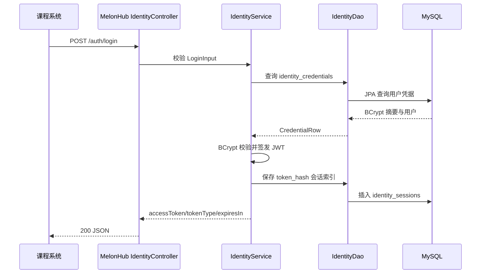

# 第二轮检查问题与回答

本文把助教检查和教师检查对应到当前代码、部署配置和联调流程。需要现场展示的内容以服务器实际部署结果为准，文档中的历史测试记录不代替现场演示。

## 一、助教检查

### 1. 两个系统是否都能部署在 Docker Swarm，权限是否由 MelonHub 管理

课程管理系统仓库已经提供 `deploy/stack.yml`，包含课程前端、课程后端和 Prometheus 的 Swarm 服务。课程后端通过 `IDENTITY_BASE_URL` 调用 MelonHub 的 `/auth/*` 接口，课程前端通过 `VITE_IDENTITY_BASE_URL` 调用同一组接口。

MelonHub 本轮新增了统一身份接口、JWT 会话索引、课程系统权限初始化脚本和 CORS 配置。课程系统的权限码、菜单权限码和角色由 MelonHub 的部门 × 软件授权域保存。

现场回答时应说明数据库连接关系。课程系统数据库保存课程业务数据，MelonHub 数据库保存统一身份、部门、角色和权限。两套系统通过 HTTP 统一身份接口协作。

### 2. 前端菜单切换能否看到后端日志

课程系统前端菜单切换会调用 `/auth/permissions/{permission}`，课程后端业务请求会进入课程后端日志。MelonHub 统一身份请求也会进入 MelonHub 的 Spring Boot 日志和请求编号链路。

现场应打开课程前端、课程后端容器日志和 MelonHub 后端日志，同时切换“课程管理、学期管理、教师管理、审计”菜单。需要展示请求路径、HTTP 结果和请求编号之间的对应关系。日志中不能出现密码、Bearer Token 或完整隐私数据。

## 二、教师检查

### 1. 如何对照需求文件和测试代码

课程系统的需求和接口主文件是课程仓库中的 `docs/requirements.md`、`api/openapi.yaml` 和 `api/openapi.json`。统一身份 8 个接口以 Apifox 的“统一身份鉴权”分组为准，MelonHub 对应契约见 [identity-openapi.yaml](identity-openapi.yaml)。

测试代码按需求编号命名，课程仓库已有前端 API 测试、后端契约测试、领域测试和真实数据库测试。联调前先验证以下最小契约：

- 登录返回 `accessToken`、`tokenType`、`expiresIn`。
- `/auth/me` 返回 `subject`、`roles`、`permissions`。
- 前端权限接口只返回 `allowed`。
- 部门和部门用户列表带 `page`、`pageSize`、`total`、`items`。
- 错误返回稳定的 `code` 和中文 `message`。

### 2. 如何运行前端并检查需求

先配置课程系统前端的 `VITE_IDENTITY_BASE_URL` 和后端的 `IDENTITY_BASE_URL`，再执行课程仓库部署说明中的构建和启动流程。使用联调教师、联调学生和课程管理员账号分别检查教师、学生和管理员入口。

MelonHub 的初始化入口是：

```powershell
./scripts/setup-course-integration.ps1 -BaseUrl http://127.0.0.1:8080 -UsersFile .local/course-users.csv
```

现场应检查登录、菜单权限、部门选择、部门用户选择、课程查看、教师操作和管理员菜单。跨域失败时先检查 MelonHub 的 `CORS_ALLOWED_ORIGINS`、课程前端 Origin 和浏览器的 `OPTIONS` 请求。

### 3. 如何查看包图、类图和时序图

课程仓库 `docs/design/` 已有结构化设计与 DDD 设计的包图、类图和时序图，图应与当前代码版本一起检查。MelonHub 新增统一身份模块的代码分层如下：

```text
controller.IdentityController
        ↓
identity.IdentityService
        ↓
dao.IdentityDao  →  entity.IdentityCredential / IdentitySession / User / Role / Permission
        ↓
MySQL
```

统一身份登录时序如下：



### 4. 结构化设计和 DDD 设计有什么不同

结构化设计按照功能分解和调用流程组织系统，Controller、Service、DAO 往往围绕用例编排数据操作，数据结构和过程边界比较明显。

DDD 设计围绕领域边界、聚合、实体、值对象、领域服务和仓储端口组织系统。应用服务负责用例编排，领域模型负责不变量，基础设施适配器负责数据库和外部系统。课程仓库同时保留结构化实现和 DDD 实现，用于对比相同 API 在两种架构下的调用链。

MelonHub 的统一身份模块属于清晰的应用服务分层。`IdentityService` 负责认证与权限规则，`IdentityDao` 负责持久化查询，Controller 只负责 HTTP 适配。课程系统的 DDD 代码仍由课程仓库负责，MelonHub 不把课程实体复制进权限系统。

### 5. 某个 API 体现了哪个 GRASP 原则

以 `GET /auth/permissions/{permission}` 为例：

- Controller 只负责提取请求头和路径参数，体现 Controller 原则。
- `IdentityService` 持有认证和权限判断所需的信息，负责完成用例，体现 Information Expert。
- `IdentityDao` 集中处理 JPA 查询，避免 Controller 直接访问数据库，体现 Low Coupling。
- `IdentityTokenService` 独立处理 JWT 签发和校验，减少认证细节对业务服务的影响，体现 Pure Fabrication 和 Protected Variations。

以课程系统的课程删除 API 为例，Controller 不判断课程是否已有学生或小组，Service 根据领域对象和仓储结果作出决定，避免把业务规则散落在 HTTP 层。

## 三、当前联调前检查清单

- [ ] MelonHub 后端健康检查正常。
- [ ] `IDENTITY_JWT_SECRET` 已替换为随机长密钥。
- [ ] `CORS_ALLOWED_ORIGINS` 包含课程前端实际 Origin。
- [ ] 课程软件编码为 `course-project-management`。
- [ ] 课程角色、后端权限码、菜单权限码已由初始化脚本建立。
- [ ] 联调用户已经导入，教师和学生分配了对应角色。
- [ ] 课程后端 `IDENTITY_BASE_URL` 指向 MelonHub。
- [ ] 课程前端 `VITE_IDENTITY_BASE_URL` 指向浏览器可访问的 MelonHub 地址。
- [ ] 登录、当前用户、前端权限和部门用户接口已用真实 Bearer JWT 验证。
- [ ] 课程前端菜单切换时能在日志中看到对应请求。

## 四、本次服务器核对结果

本次只读核对确认服务器已有 Docker Swarm 和 `javaee-proxy` 网络，已有 `lab_mysql` 服务可以启动。服务器 `melonhub_rbac` 已应用旧权限模型的 `V6__role_owned_permissions` 和 `V7__application_shared_permissions`。仓库保留这两个原始迁移文件以通过 Flyway 校验，新增的旧库兼容、管理员功能、管理员树和统一身份迁移依次使用 `V8`、`V9`、`V10`、`V11`。

旧 V6/V7 改变过角色和权限表结构，与当前代码的“部门 × 软件”模型存在结构差异。V8 兼容迁移按已有用户授权关系补回部门域并保留原授权，未执行 Flyway repair、未重建数据库、未删除数据库数据。迁移完成后 JPA 校验和后端启动均已通过。

## 五、联调部署结果

MelonHub 已部署到现有 Swarm，后端和前端均为 `1/1`。后端健康检查返回数据库 `UP`，缓存关闭，未登录访问 `/auth/me` 返回 401。课程系统所需的部门、软件、后端权限、菜单权限、角色和三类联调用户已经通过 MelonHub 管理接口建立，教师、学生和管理员账号的登录、当前用户、权限查询和部门查询均已回读验证。

课程前端已按 `VITE_IDENTITY_BASE_URL=http://服务器地址:18080` 构建并部署，前端健康检查为 `ok`。课程后端镜像已创建 Swarm 服务，但服务器已有其他应用占满 MySQL 连接，课程后端 Flyway 启动阶段收到 `Too many connections`，因此业务后端副本暂未达到 `1/1`。没有停止、重启或修改其他应用服务。释放服务器数据库连接后，课程后端服务会按现有 Stack 配置自动重试启动。
