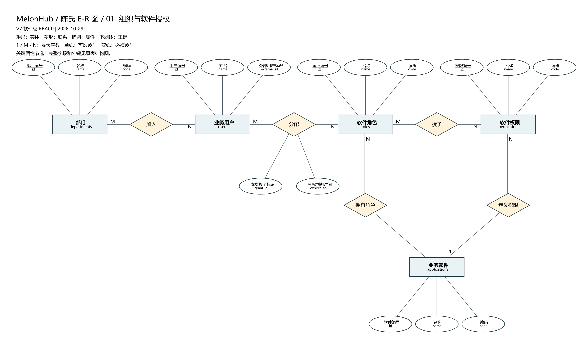
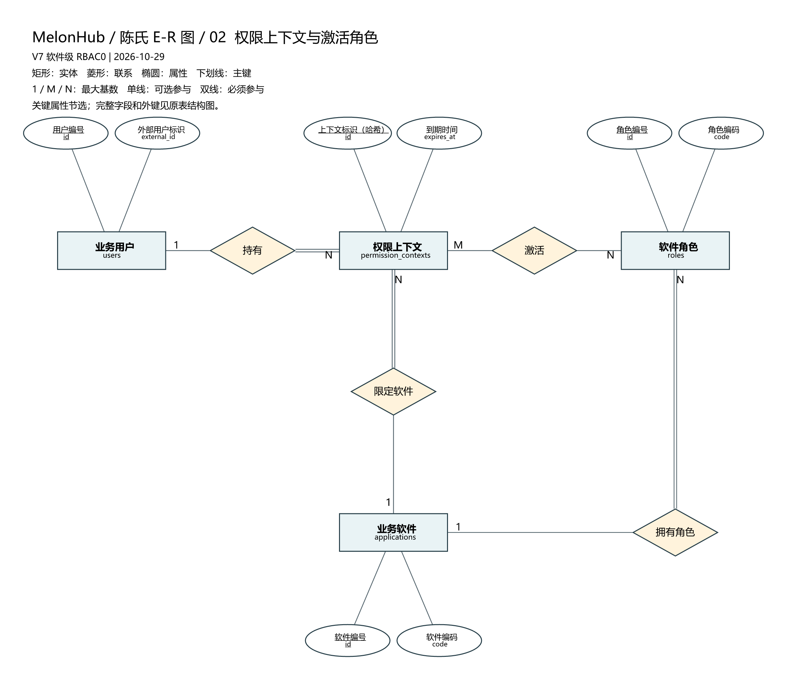
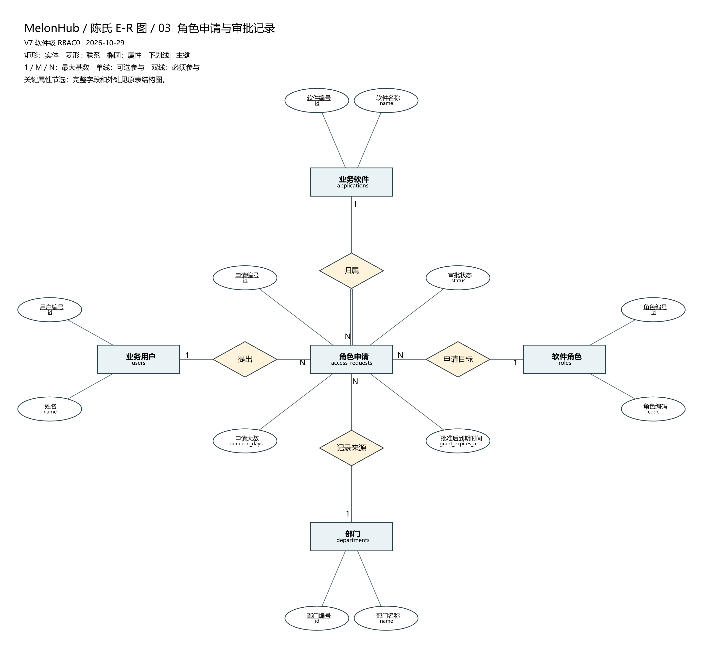
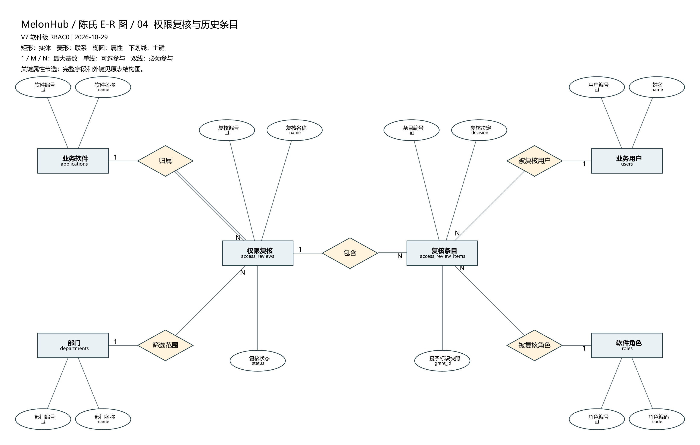
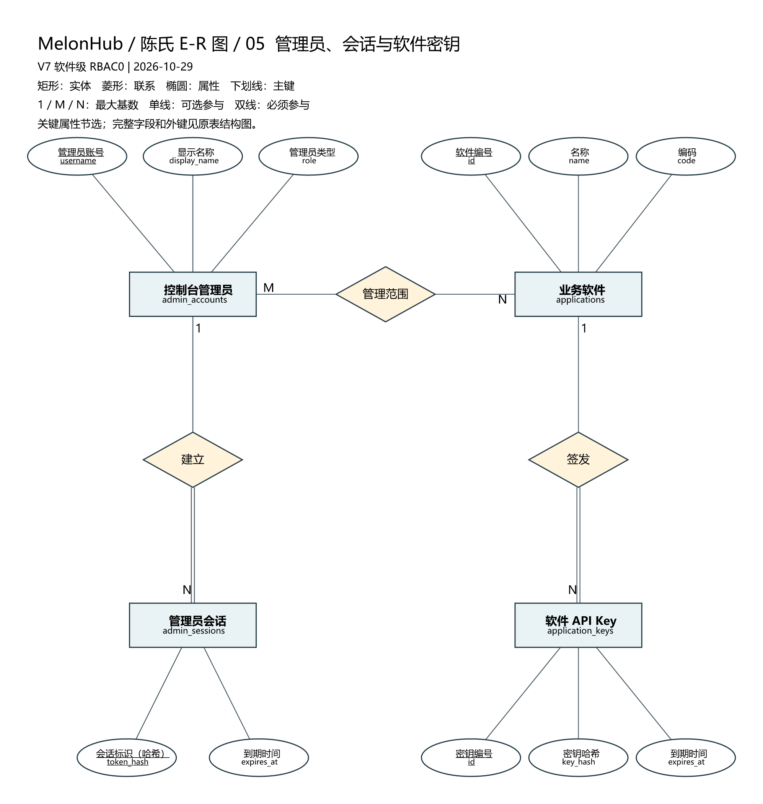
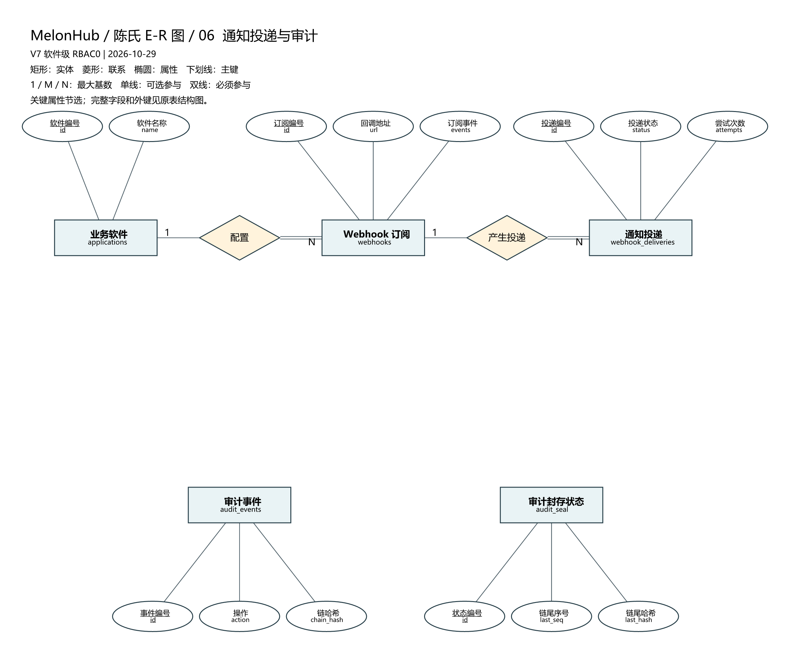

= MelonHub 数据库 E-R 图（陈氏图）

:toc: left
:toclevels: 4
:sectnums:
:source-highlighter: highlight.js

更新日期：2026-10-29。依据已核对 Flyway V1–V7 的 link:ER/schema.json[结构快照]，新增陈氏（Chen）概念模型版本。原有 link:数据库E-R图.adoc[数据库表结构 E-R 图] 完整保留，两种版本分别用于讲解概念关系和核对物理表结构。

本版以六张分图展示 *16 类实体、5 类多对多联系，合计映射 21 张运行表*；同一实体可以在多张图中出现。图中只列关键属性，不展开所有字段。三张迁移归档表及 Flyway 管理表属于历史和技术管理范围，仍在原版全表图中展示；不能将本版称为“25 张表、30 条外键的完整物理结构图”。本次使用已有结构快照，没有重新连接云数据库。

== 读图约定

[%header,cols="1,1,1"]
|===
|符号
|含义
|项目中的例子

|矩形
|实体；下方英文给出对应表名
|业务用户、软件角色、软件权限

|菱形
|实体之间的联系
|用户“分配”角色、角色“授予”权限

|椭圆
|实体属性或联系属性；下方英文给出列名
|用户编号、权限编码、分配到期时间

|属性下划线
|实体主键
|users.id、admin_accounts.username

|1、M、N
|联系的最大基数；M 和 N 都表示多
|用户与角色为 M:N；软件与角色为 1:N

|实体与联系之间的单线
|部分参与，可以没有这类联系
|用户可以尚未分配任何角色

|实体与联系之间的双线
|全参与，每个该类实体都必须参与联系
|每个角色必须属于一个软件

|===

基数标在实体一侧。例如“业务软件 1 — 拥有角色 — N 软件角色”表示一个软件可拥有多个角色，一个角色只能属于一个软件；角色侧的双线进一步表示角色不能没有所属软件。1 是最大值，不单独表示引用必填，最小参与数由单线/双线区分。

属性线没有基数；`grant_id` 画在“分配”菱形旁，因为它描述某次用户—角色分配，不是用户或角色本身的属性。软件内编码唯一等复合约束使用正文说明，不将 `code` 错画成全局主键。

== 1. 组织与软件授权

link:ER/陈氏/01-核心授权.svg[放大 SVG] · link:ER/陈氏/01-核心授权.png[高清 PNG] · link:ER/陈氏/01-核心授权.dot[DOT 源文件]

- 部门与用户通过“加入”构成 M:N，映射 `memberships`。用户可以没有部门或加入多个部门。
- 用户与角色通过“分配”构成 M:N，映射 `user_roles`；`grant_id` 和 `expires_at` 是联系属性。到期时间为空表示永久分配。
- 角色与权限通过“授予”构成 M:N，映射 `role_permissions`。同一权限定义可以被同软件的多个角色引用。
- 软件与角色、软件与权限分别为 1:N。每个角色、权限都必须归属一个软件；软件可以暂时没有角色或权限。
- 同一软件内角色编码、权限编码各自唯一；“授予”的两端必须属于同一个软件，由服务校验和数据库复合外键共同约束。

部门仅组织用户，不拥有角色或权限；本图没有部门授权、角色继承或用户直接权限关系。`users.active_department_id` 为历史兼容字段，`user_roles.department_id` 为可空来源信息，均未作为核心概念联系绘制；实际外键仍可在原版图中查到。

== 2. 权限上下文与激活角色

link:ER/陈氏/02-权限上下文.svg[放大 SVG] · link:ER/陈氏/02-权限上下文.png[高清 PNG] · link:ER/陈氏/02-权限上下文.dot[DOT 源文件]

每个上下文必须对应一个用户、一个软件；用户和软件都可以对应多个上下文。上下文与角色通过“激活”构成 M:N，映射 `context_roles`；同一角色可以在多个上下文中被激活。

“激活”联系表达存储关系。创建上下文时，服务还会检查角色是否属于该软件、是否已分配给用户及是否有效；在线校验也需要检查启用状态和分配期限。不能仅凭图上存在连线就判断允许某个操作。上下文标识仅保存 token 的 SHA-256，不是明文 token。可空的 `permission_contexts.department_id` 不作为授权边界，图中省略该来源信息。

== 3. 角色申请与审批记录

link:ER/陈氏/03-角色申请.svg[放大 SVG] · link:ER/陈氏/03-角色申请.png[高清 PNG] · link:ER/陈氏/03-角色申请.dot[DOT 源文件]

角色申请有自己的编号、审批状态和申请期限，因此作为独立实体，而不是直接画成用户—角色的授权联系。申请通过后，服务才可能建立或更新 `user_roles` 中的分配；申请记录本身不授予权限。

每条申请必须归属一个软件。部门来源可以为空；用户和角色在正常发起时由服务校验，之后删除用户或角色会将历史申请引用置空并保留名称快照，所以图中相应的申请侧使用单线。这里表达可保留的数据库状态，不表示允许任意创建无用户、无目标角色的申请。

`pending_role_id` 用于待审批唯一约束，没有指向角色的外键，本图不另画一条关系；`requested_by`、`decided_by` 是操作人文本，也不推导为管理员实体外键。

== 4. 权限复核与历史条目

link:ER/陈氏/04-权限复核.svg[放大 SVG] · link:ER/陈氏/04-权限复核.png[高清 PNG] · link:ER/陈氏/04-权限复核.dot[DOT 源文件]

软件与复核为 1:N，每条复核必须属于软件；复核与条目为 1:N，每个条目必须属于某轮复核。复核可选择一个部门作为人员筛选范围，也可以不筛选部门，这不构成部门授权隔离。

条目保存被复核用户、角色及授予标识快照。用户、角色删除后，相应引用可以为空，名称等历史快照仍保留，因此条目在这两类联系中为可选参与。

条目的 `grant_id` 是对某次授予的快照，不是外键。关闭复核时，服务比对同一次授予，避免错误回收已续期或重新授予的分配。本图不虚构“条目必须引用当前分配”的数据库联系；`department_id` 快照也没有部门外键。

== 5. 管理员、会话与软件密钥

link:ER/陈氏/05-管理员密钥.svg[放大 SVG] · link:ER/陈氏/05-管理员密钥.png[高清 PNG] · link:ER/陈氏/05-管理员密钥.dot[DOT 源文件]

管理员与软件通过“管理范围”构成 M:N，映射 `admin_account_applications`；这张关联表记录显式软件范围，不表示超级管理员、平台管理员必须逐个绑定软件。管理员类型是 `admin_accounts.role` 属性，不是业务 `roles` 表的外键。

一个管理员可以建立多个会话，每个会话必须属于一个管理员；一个软件可以签发多个 API Key，每个 Key 必须属于一个软件。每软件最多十个有效 Key 是服务规则，图中的 N 不表示没有业务上限。会话 token 与 API Key 只存哈希。

控制台管理员与业务用户是两套独立身份，不能增加它们之间的用户登录或角色分配连线。

== 6. 通知投递与审计

link:ER/陈氏/06-通知审计.svg[放大 SVG] · link:ER/陈氏/06-通知审计.png[高清 PNG] · link:ER/陈氏/06-通知审计.dot[DOT 源文件]

软件与 Webhook 订阅为 1:N，订阅与通知投递为 1:N；每条订阅必须归属软件，每条投递必须归属订阅。投递实体承载事务外盒、重试和结果状态。

审计事件、审计封存状态作为独立实体展示。两者的链尾及哈希关联由应用维护，没有物理外键；审计事件中的软件、部门标识也没有物理外键。本版不将它们推导成受外键约束的实体联系。独立绘制不代表它们在业务上毫无联系，完整审计行为见架构说明。

== 联系与关联表对应

[%header,cols="1,1,1,1"]
|===
|图中联系
|对应关联表
|两端实体
|关键说明

|加入
|memberships
|部门、业务用户
|组织成员 M:N

|分配
|user_roles
|业务用户、软件角色
|M:N，带授予标识、到期时间等联系属性

|授予
|role_permissions
|软件角色、软件权限
|M:N，两端必须同软件

|激活
|context_roles
|权限上下文、软件角色
|M:N，合法激活范围由服务补充校验

|管理范围
|admin_account_applications
|控制台管理员、业务软件
|M:N，显式可管理软件范围

|===

其余 16 张运行表直接映射成矩形实体；每张实体的英文字样可用于定位数据库设计中的字段表。陈氏图将上述五类关联抽象为联系，不能据此推断数据库里删除了这五张表。

== 文件与重建

六张图的 PNG、SVG 和 DOT 均在 link:ER/陈氏/[ER/陈氏]；生成器是 link:ER/render-chen.cjs[render-chen.cjs]，与原版 `render.cjs` 分开维护，重建不会覆盖原图。

在项目根目录执行，依赖与原版绘图工具共用：

[source,powershell]
----
npm.cmd install --prefix .local/er-tools --no-audit --no-fund --ignore-scripts @viz-js/viz@3.9.0 @resvg/resvg-js@2.6.2
node docs/ER/render-chen.cjs
node scripts/convert-docs-to-adoc.mjs
----

使用 Windows 微软雅黑绘制中文；其他系统应安装相应字体或修改生成器的字体设置。生成器会校验关键属性存在、联系有外键依据、全部运行表均映射到实体或联系。单/双线依据快照外键列是否可空生成；服务层规则和历史兼容字段的省略需人工结合本文核对。

Markdown 与 link:数据库E-R图-陈氏.adoc[AsciiDoc 版本] 使用同一批图片。仅重建图片和文档无需数据库连接，也不读取 `.env`。未来发生结构迁移时，先核对并更新快照与概念模型，再重新生成并目视检查六张图片。
