# MelonHub 概要设计说明书

版本：1.0　编制日期：2026-11-12　设计基线：当前代码与 Flyway V7

本文面向课程评阅、项目开发与业务软件接入人员，给出 MelonHub 统一权限平台的系统骨架、职责分配、接口契约、全局数据与部署设计，并进行轻量级 ATAM 评估。系统采用前后端分离、后端分层单体和软件级 RBAC0：软件隔离角色与共享权限，部门负责人员组织与筛选，平台只判断授权，业务软件负责真实用户认证与业务执行。

依据本次项目指示，当前代码是本说明书的业务基线。原《统一权限系统软件需求说明书》中的部门权限域等规则与代码存在差异，因此另附《需求基线校正》，以 CF、CN 编号表达校正后的功能与质量要求；第 9 节仍逐条保留原 FR、NFR、UC 及分析图号对照。本文不把拟议改进或历史测试结果当作当前上线验收结论。

文档组成：本 Markdown 为可编辑正文；`概要设计/figures/` 保存 PlantUML 源文件及 PNG、SVG；配套 PDF 为提交阅读版；`概要设计/模板与交付说明.md` 保存模板来源、章节目映射和重建方法。组号未提供，提交时按课程登记信息加在 PDF 文件名前。

## 1 引言与总体设计

### 1.1 编写目的

在需求和详细设计之间确定系统边界、架构选择、模块职责、模块协作及全局约束，使设计可以追溯、评估和进一步细化。本文不展开算法、完整字段字典、配置脚本或代码级 API 签名。第 4.1 节仅保留核心设计类的业务操作名称。

### 1.2 项目背景与范围

MelonHub 为企业内部 20 多个软件提供集中授权能力。控制台维护人员、软件、角色、共享权限和分配关系；可信业务后端使用 API Key 创建上下文，并在每次受保护操作前在线校验。平台支持临时授权、申请审批、复核、签名通知、审计和 Java SDK。管理员账号与业务用户资料独立。

软件是授权隔离边界。部门成员变化不撤销软件角色或上下文；无部门用户可以申请、获批和创建上下文。有效权限为当前软件中已激活、已分配、启用且未到期角色的权限编码并集。无用户直接权限、角色继承、ABAC、通配授权、职责分离及 OAuth/OIDC/IdP/SSO。权限码区分大小写，resource/action 仅作元数据。

### 1.3 术语与编号

表 1-1 术语与标识

| 名称 | 含义 |
| --- | --- |
| RBAC0 | 用户通过显式角色分配取得权限；无角色继承 |
| 软件 / 应用 | applications 所表示的接入软件，两词在本文等价 |
| 权限上下文 | 业务用户在指定软件中的激活角色与有效性引用，不是用户登录凭证 |
| 授予实例 grant_id | 同一用户角色关系某次授予的标识，续期或重授后改变 |
| 事务外盒 | 与业务变更同事务保存待投递记录，提交后异步通知 |
| 代标记 / epoch | 缓存失效版本与全局纪元，用于避免旧结果回填污染新读取 |
| CF / CN | 代码基线校正后的功能需求 / 质量需求 |
| AD / ST / U | 架构决策 / 架构故事 / 效用树叶节点 |
| M / API / INT / EXT / DS | 模块 / HTTP 接口族 / 进程内接口 / 外部连接 / 数据策略 |

### 1.4 参考资料与模板

表 1-2 参考资料

| 编号 | 资料与用途 |
| --- | --- |
| REF01 | 本次《概要设计说明书》作业要求：章节、边界、建模与评分依据；副本见 `概要设计/作业要求.txt` |
| REF02 | `统一权限系统软件需求说明书.docx`，2026-10-24 版本 1.0 草案：原 FR、NFR、UC 与图号来源 |
| REF03 | `概要设计/需求基线校正.md`：当前代码需求定义及原规格差异 |
| REF04 | `详细设计.md`、`数据库设计.md`、`ARCHITECTURE.md`：职责、V7 关系与缓存协议参考，发生冲突时以源码核对 |
| REF05 | `API.md`、`openapi.json`、五个 Controller、Requests：实际接口契约 |
| REF06 | `backend/src/main`、`frontend/src`、`sdk/java/src/main`、Flyway V1–V7：本次设计的实现证据 |
| REF07 | `服务器部署与启动.md`、部署脚本、`验证记录.md`：当前部署方式、历史证据与未验证范围 |
| REF08 | GB/T 8567 系列概要设计常用六章模板：引言、总体设计、接口设计、运行设计、系统数据结构设计、系统出错处理设计；完整章节目映射和保留内容见附录 A |

模板采用 REF08 的六章概要设计结构，并按课程指定的九节顺序组织正文。原模板标题与各子节在附录 A 全部保留、填写或给出正文位置；未删除不适用章节。此为课程适配文档，不声称通过标准符合性认证。

### 1.5 需求概述

功能基线 CF01–CF13 覆盖管理员认证、组织资料、软件与密钥、RBAC 配置、管理员范围、分配与期限、上下文、在线校验、申请复核、导入报表、Webhook、审计监控和控制台/SDK。完整定义见 REF03，第 9 节给出对应关系。

质量基线 CN01–CN08 分别落实安全隔离、事务与一致性、性能与容量、故障与恢复、易用性、可维护性与可移植性、凭据与审计、数据完整性。当前服务器 Redis 默认关闭；单后端和单持久入口不构成高可用部署。性能、可用性与恢复数值须经实际环境确认。

### 1.6 设计原则与约束

服务端为最终授权点，前端隐藏菜单只辅助交互；调用软件由凭据确定，目标对象必须二次验证所属。Controller 处理 HTTP 与访问范围，Service 处理业务规则和事务，DAO 处理查询、锁和持久化。每个请求只在明确的数据边界中工作，业务操作始终由外部软件执行。

采用高内聚、低耦合和有限资源策略，不机械增加空转层。MySQL 是唯一持久数据源，Redis 数据可重建；已应用的 V1–V7 不修改，后续结构变更加新迁移。源码目标 Java 17，服务器 JDK 21；前端 Vue 3、TypeScript、Ant Design Vue 4。配置、凭据和真实服务器地址不写入设计文档。

## 2 总体架构设计与评估

### 2.1 架构设计

#### 2.1.1 架构风格选择与理由

采用客户机—服务器、前后端分离和后端分层单体。控制台与业务后端分别通过 HTTP 接入同一应用；后端按控制、业务、数据访问及横切安全/缓存职责拆包。授权写入、审计和外盒需要共同事务，分层单体可在单一 MySQL 事务内完成，降低分布式一致性与运维成本，适合现有规模和课程团队。

暂不拆微服务：当前没有独立团队、独立扩容及跨域部署证据；拆分会引入分布式事务和多服务鉴权。单体的代价是共享资源、发布和故障域，需以限流、独立通知线程池、事务边界和监控控制。未来可并列部署应用实例，但须先验证共享缓存、全局限流、定时任务及恢复行为。

#### 2.1.2 系统总体结构

图 2-1 区分客户端、单体内部边界和数据设施；可选 Redis 用虚线标识。外部软件先认证用户，平台仅返回授权结论。

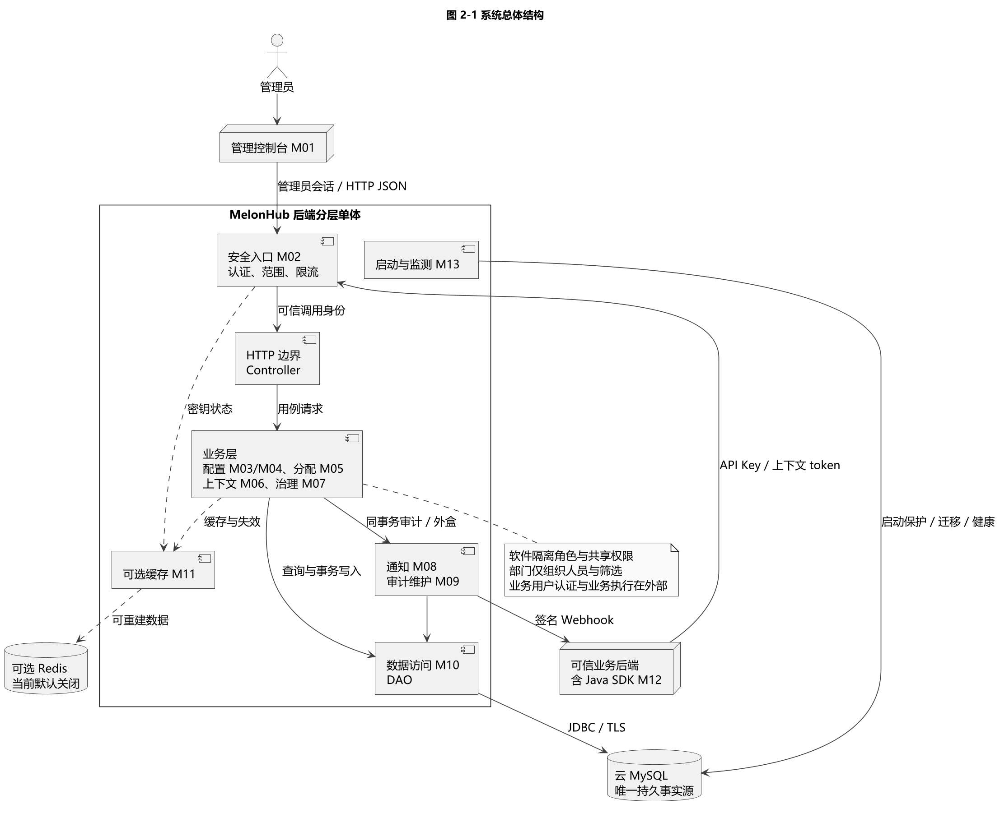

#### 2.1.3 关键架构决策

表 2-1 关键架构决策及质量目标

| 编号 | 决策与理由 | 对应需求 | 状态 |
| --- | --- | --- | --- |
| AD01 | 分层单体，Controller/Service/DAO 分责；单事务协调授权、审计、外盒，降低跨服务复杂度 | CF03–CF12；CN02、CN06 | 已实现 |
| AD02 | 软件级 RBAC0，角色和权限共享定义分别归属软件，数据库复合外键拒绝跨软件关联 | CF02、CF04、CF06、CF08；CN01、CN08 | V7 已实现 |
| AD03 | ApiGuard 默认拒绝；API Key 固定软件；AdminAccess 逐接口校验角色与软件范围 | CF01、CF03、CF05、CF08；CN01、CN07 | 已实现 |
| AD04 | MySQL 唯一事实源；写路径统一锁序、条件更新及 grant_id；授权读取不加行锁 | CF06、CF08、CF09；CN02、CN08 | 已实现 |
| AD05 | 可选 Redis 结果缓存采用代标记、busy、epoch 与到期上限；故障熔断回源 | CF07、CF08；CN02–CN04 | 客户端已实现，服务器默认关闭 |
| AD06 | 软件限流、有限连接/线程/队列，资源不足快速返回可重试错误 | CF03、CF08、CF12；CN03、CN04 | 已实现；容量待云链路压测 |
| AD07 | Webhook 使用同事务外盒、条件认领、租约及有上限重试；独立发送线程池隔离慢接收方 | CF09、CF11；CN02、CN04 | 已实现 |
| AD08 | 高随机凭据哈希保存、口令 BCrypt、管理员凭据版本与 TOTP；审计链提示篡改 | CF01、CF03、CF12；CN07、CN08 | 已实现；签名/TOTP 密钥仍原文存库 |
| AD09 | 服务器后端容器 + 本机控制台/SSH 通道，数据库 TLS；正式/测试隔离，迁移版本化 | CF12、CF13；CN04、CN06、CN08 | 当前运行方式；非 HA |
| AD10 | 进程内 SDK 复用上下文但逐操作在线鉴权；控制台丢弃过时响应，失败关闭 | CF07、CF08、CF13；CN01、CN04、CN05 | 已实现 |

### 2.2 架构故事

以下五个故事先以表 2-2 明确刺激与可观察响应，再构建效用树。度量分为代码约束、建议验收目标；建议值不等于已通过。每个故事包含 ATAM 六要素。

表 2-2 架构故事与六要素

| 要素 | ST01 性能与过载保护 | ST02 跨软件越权防护 |
| --- | --- | --- |
| 需求 | CN03，CF08；原 3.2.3 性能建议 | CN01、CN07，CF03、CF05；原 NFR01–03 经校正 |
| 叙事 | 21 个软件接入，在管理变更同时持续在线鉴权，资源有界且结果正确 | 调用方持软件 A 密钥构造软件 B 的角色/上下文标识，平台拒绝且不泄露 B 数据 |
| 刺激源 | 多个可信业务后端 | 受限软件调用方或受限管理员 |
| 刺激 | 持续 200 请求/秒 10 分钟，含正常授权查询；另施加超额流量 | 请求其他软件对象或超出管理员可见软件的接口 |
| 环境 | 1 万用户、至少 21 软件；固定云链路、4 核 8GB 应用与独立数据库；分别测缓存关闭/启用 | 系统正常运行，A/B 含同名权限码，凭据有效但目标越权 |
| 制品 | API 入口、上下文模块、缓存和 MySQL | ApiGuard、AdminAccess、所属校验、复合外键 |
| 响应 | 正常调用按当前有效状态判断；超限 429，资源不足 503，均带可重试提示 | 401/403/404 或对象校验失败，无越权写入、无跨软件数据 |
| 响应度量 | 建议 p95 ≤ 200ms、p99 ≤ 500ms，错误放行/跨软件泄露为 0；超额样本单独统计 | 预设越权反例全部拒绝，A 写入后 B 数据不变；凭据明文泄露为 0 |

表 2-3 一致性、恢复及可修改性故事

| 要素 | ST03 撤权与到期一致性 | ST04 慢接收方与故障恢复 | ST05 配置接入与可修改性 |
| --- | --- | --- | --- |
| 需求 | CN02、CN08，CF06、CF08、CF09；原 NFR04–06 边界校正 | CN04，CF11、CF12；原 NFR07、NFR08 部分 | CN05、CN06，CF04、CF10、CF13；原 NFR09、NFR10 |
| 叙事 | 管理员回收/续期与在线校验并发，提交后的读取不受旧快照回填影响，旧复核不误撤新授予 | 一个 Webhook 接收方超时或投递实例中断，授权提交保持独立，记录可恢复且旧认领者不能覆盖新状态 | 新软件配置角色和共享权限后接入，平台无需改动发布，控制台不会被旧查询覆盖 |
| 刺激源 | 管理员、到期时钟、复核操作员 | 慢业务接收端或失效发送进程 | 新接入软件维护者与控制台用户 |
| 刺激 | 回收、续期、角色权限改变、到期及旧复核关闭 | 已提交外盒待发送；HTTP 超时或 SENDING 租约到期 | 导入软件级 v3 清单；快速切换软件并搜索 |
| 环境 | 缓存关闭或健康；另测写实例无法连接 Redis 的部分故障 | 数据库可用，接收方不可达或发送进程重启 | 系统正常运行、接口契约稳定 |
| 制品 | 授权事务、ContextService、PermissionCache、grant_id | WebhookService、WebhookDao、发送池与外盒 | 配置模块、v3 清单、前端状态、SDK |
| 响应 | 正常协议下提交后开始的校验读取新状态；到期不再计入；重授不被旧快照回收 | 写事务不等待 HTTP；超时后退避，租约过期回队或进入失败终态 | 动态配置生效，接口不随软件增添而改码，旧页面响应被丢弃 |
| 响应度量 | 正常/关闭缓存测试中错误放行为 0；到期边界测试为 0；部分故障的旧结果上界为最长结果 TTL 60 秒，非绝对即时 | 外盒记录不因发送进程失效丢失；每次认领有版本条件；重试次数有上限；重复交付由接收方去重 | 新软件接入所需平台源码改动为 0；v1/v2 导入被明确拒绝；过时响应覆盖当前状态次数为 0 |

ST04 的“记录不丢失”以前置数据库持久性为条件；外盒提供有上限重试与失败可见性，不提供端到端恰好一次。ST03 的缓存部分故障窗口是评估发现，不修改为强一致承诺。

### 2.3 轻量级 ATAM 评估

#### 2.3.1 质量属性效用树

图 2-2 以效用为根。括号为“重要性，实现难度”，H/M/L 分别表示高/中/低；重要性来自授权安全与课程目标，实现难度为本次工程判断，不假称召开过利益相关者评审会议。

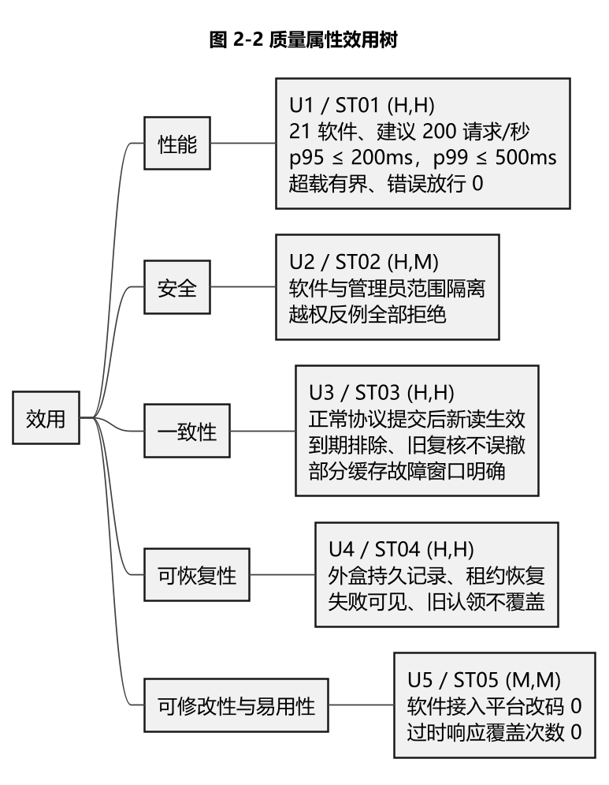

叶节点 U1=ST01、U2=ST02、U3=ST03、U4=ST04、U5=ST05。U1–U4 为重点评估对象；第 4.4 节选择 U1/U2、U3、U4 形成运行时分析闭环。

#### 2.3.2 架构方法识别与分析

表 2-4 高优先级场景分析

| 场景 | 已有方法与作用 | 可验证证据与局限 |
| --- | --- | --- |
| U1/ST01 | AD05 可选缓存减少重复计算；AD06 按软件限流、连接池与队列上限避免无限排队 | 需在当前云链路分别测缓存关闭/启用；限流上限是保护配置，不是吞吐保证；缓存关闭时数据库为主要瓶颈 |
| U2/ST02 | AD02 软件归属和复合外键；AD03 默认拒绝、逐接口范围校验；AD08 凭据不回显 | ControllerIntegrationTest、SecurityIntegrationTest 及迁移测试为已有入口；业务后端若伪造 externalId，平台无法代替其认证 |
| U3/ST03 | AD04 同事务、锁序、grant_id；AD05 事务前后代失效、busy 与 epoch，结果受最早到期约束 | 读授权无行锁，提交重叠请求可能看到旧结果；Redis 部分网络故障可能出现最长 60 秒旧结果窗口 |
| U4/ST04 | AD07 事务外盒、独立发送池、有条件认领及结果回写；AD05 故障回源 | WebhookDaoTest、WebhookServiceTest 提供已有入口；数据库仍是单一依赖，FAILED 需运维处理，接收方需按事件标识去重 |
| U5/ST05 | AD01 分层、AD02 动态定义、AD09 迁移、AD10 前端异步防串页 | v3 清单、前端回归、SDK 契约可验证；Map 响应降低编译期契约保障，不兼容变更仍需迁移说明 |

#### 2.3.3 评估发现

表 2-5 风险点、非风险点、敏感点与权衡点

| 编号与类别 | 决策、论证及质量影响 |
| --- | --- |
| R1 风险 | AD05 在写实例 Redis 不可达时允许 MySQL 事务继续提交；其他实例可能仍命中旧代结果；削弱跨实例撤权即时性，窗口受最长结果 TTL 限制 |
| R2 风险 | AD09 当前单应用实例及单云数据库入口；任一节点故障会中断服务，容器重启不能覆盖数据库失效；无法据此承诺 99.9% 或恢复时限 |
| R3 风险 | AD07 允许登记任意 http(s) Webhook 目标，且签名密钥/TOTP 密钥可计算而以原文存库；管理员错误配置或数据库泄露会扩大目标访问与密钥泄露风险；削弱安全隔离和凭据保密 |
| R4 风险 | AD01 部分接口返回 Map，且核心 RbacService 较集中；字段变更容易依赖运行测试才发现；增加契约回归和修改影响面 |
| NR1 非风险 | AD02 在同软件内复用权限并由复合外键限制跨软件关联；应用校验遗漏仍有数据库约束兜底；提升数据完整性与隔离性 |
| NR2 非风险 | AD07 外盒和业务写同事务，提交前不对外发送，条件认领限制过时写回；发送中断仍有待办记录；提升可恢复性 |
| S1 敏感 | AD05 最长结果 TTL 与最早到期上限直接控制旧允许结果窗口及缓存命中率；期限处理偏差会影响授权正确性，不能只调大 TTL 求性能 |
| S2 敏感 | AD06 数据库连接池、限流和请求并发预算共同决定排队和吞吐；只提高线程数可能增加数据库竞争，必须整体压测 |
| T1 权衡 | AD04 授权读取不加行锁，减少校验阻塞并提高吞吐，同时允许与提交重叠的请求读取旧快照；一致性承诺以提交后开始的读取为边界 |
| T2 权衡 | AD05 缓存故障时回源提高连续服务能力，但增加数据库压力，部分故障削弱即时一致性；敏感场景可关闭缓存，代价是更高数据库负载 |
| T3 权衡 | AD08 同库审计链便于实现和校验，开销可控；具备全库写权限者可重算链，外部不可抵赖性不足 |

#### 2.3.4 评估结论与改进

表 2-6 具体改进建议

| 编号 | 改进与验收办法 | 与 2.1 方案关系 |
| --- | --- | --- |
| IMP1 | Redis 启用前完成多实例失效、到期、部分网络故障、恢复 epoch 验证和当前云链路压测；对要求零撤权宽限的部署保持缓存关闭 | AD05 已包含关闭与回源机制；测试准入为建议，服务器 Redis 未验收 |
| IMP2 | 根据正式 SLA 配置隔离备份并做恢复演练，核对恢复后的授权和审计；需要可用性目标时再评估双实例、负载均衡、数据库 HA | AD09 当前容器与数据分离已体现；备份演练、HA 拓扑尚未实现为当前承诺 |
| IMP3 | 为 Webhook 增加部署级出站目标限制及密钥保护；优先收敛稳定接口的强类型响应并补兼容校验 | 对应 AD07/AD08/AD01 的风险改进；本次仅提出，未混入现有设计实现描述 |

结论为“架构适合当前软件级授权平台，需保留缓存一致性、单节点恢复和凭据保护的明确边界”。本节按设计、故事、效用树、分析、改进顺序评估；不将建议当作已解决的风险。

## 3 模块设计与逻辑架构

### 3.1 包与组件分层

图 3-1 只表示包/组件粒度。安全和缓存为横切组件；DAO 是数据访问边界，SQL 与锁不进入 Controller 或 Service。图中模块是职责视图，M03–M05 可由同一个 RbacService/RbacDao 实现，不能据此声称已拆成独立服务。

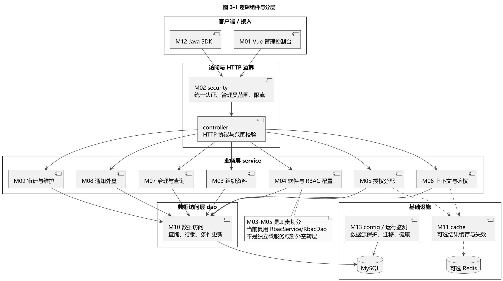

### 3.2 模块职责与功能分配

表 3-1 模块职责、输入输出与需求

| 编号及模块 | 职责与实现落点 | 核心输入 → 输出 | 需求 |
| --- | --- | --- | --- |
| M01 控制台 | 页面、身份/软件范围、异步交互和响应式布局；frontend | 管理意图、查询条件 → 可见视图与确认结果 | CF01–CF12、CF13；CN05 |
| M02 认证与访问控制 | ApiGuard、AuthService、AdminAccess、限流器；区分管理员/软件身份 | 会话或 API Key、路径 → 可信身份/允许范围或拒绝 | CF01、CF03、CF05；CN01、CN03、CN07 |
| M03 组织资料 | RbacService/RbacDao 的用户、部门、成员维护 | 人员及部门资料 → 稳定用户与成员关系 | CF02；CN08 |
| M04 软件与 RBAC 配置 | 软件、角色、共享权限和 API Key 管理 | 软件范围、配置对象 → 配置、密钥一次性原文、标识 | CF03、CF04；CN01、CN06、CN08 |
| M05 授权分配 | 期限、单人替换、角色成员替换、批量追加和强制下线 | 用户/角色集合、期限 → 分配与受影响上下文状态 | CF06；CN02、CN08 |
| M06 上下文与鉴权 | ContextService/ContextDao 计算软件权限并集、签发/注销上下文 | 软件身份、externalId、激活角色或权限编码 → token/有效集/判断 | CF07、CF08；CN01–CN04 |
| M07 治理与查询 | GovernanceService、ConsoleService；申请、复核、导入、清单、反查、报表、搜索 | 治理指令、grant 快照、筛选 → 决定、导入结果、受限数据 | CF09、CF10；CN01、CN02、CN05 |
| M08 通知外盒 | WebhookService；订阅、可靠排队、异步签名投递与结果维护 | 事务内授权事件 → 投递记录、签名 HTTP、终态 | CF11；CN02、CN04、CN07 |
| M09 审计与维护 | AuditSealService、MaintenanceService 及服务中的审计写入；到期、封存和保留期 | 操作记录、时钟 → 可查审计链、到期/清理结果 | CF12；CN04、CN07、CN08 |
| M10 数据访问 | Rbac/Auth/Context/Governance/Webhook/Audit DAO；事务内 SQL、行锁和条件更新 | 受验证的数据请求 → 持久化记录与查询视图 | CF01–CF12；CN02、CN08 |
| M11 可选缓存 | PermissionCache；代标记、busy、epoch 和结果回填 | 上下文/凭据哈希、失效范围 → 命中或回源决定 | CF03、CF07、CF08；CN02–CN04 |
| M12 Java SDK | MelonHubClient、Authorizer、拦截器和验签器 | 可信用户、受保护操作、通知 → 在线判断/拒绝、上下文重建 | CF13、CF07、CF08、CF11；CN01、CN04、CN06 |
| M13 运行与监测 | 启动保护、Flyway、健康接口、运行脚本和容器 | 外置运行配置、监测请求 → 合法启动、运行状态和迁移结果 | CF12；CN04、CN06、CN08 |

### 3.3 模块间概要契约

表 3-2 定义主要进程内接口，详细通信约定见第 5 节。表中名称为契约标识，不是新增 Java 接口类型或代码函数签名。

| 编号 | 调用方 → 提供方 | 接口名称与功能 | 核心输入 → 输出 | 协议 |
| --- | --- | --- | --- | --- |
| INT01 | HTTP 入口 → M02 | 调用身份与范围校验 | 凭据/路径/目标软件 → 可信身份、范围或异常 | 进程内调用、请求上下文 |
| INT02 | M03–M09 → M10 | 业务数据访问 | 实体标识/筛选/锁意图 → 数据或持久化结果 | 进程内 JDBC 数据访问 |
| INT03 | M04/M05/M07/M09 → M11 | 授权失效登记 | 用户/软件/密钥影响集合、事务状态 → 代失效或故障标记 | 进程内、事务同步回调 |
| INT04 | M06/M02 → M11 | 有效结果或密钥状态查找 | 哈希标识/版本范围 → 命中、绕过或回填资格 | 进程内；可选 Redis Lua |
| INT05 | 授权写模块 → M08 | 同事务事件排队 | 软件、事件类型、非敏感变更摘要 → 外盒记录 | 进程内，共享 MySQL 事务 |
| INT06 | 各业务模块 → 审计存储，M09 → M10 | 操作留痕、封存与维护 | 操作上下文/记录/时钟 → 审计或维护结果 | 进程内/定时任务 |

调用约束：先经 INT01 形成可信身份，Controller 进行目标范围校验后进入业务；INT02 不直接暴露给外部调用方。改变授权的事务同时协调 INT03、INT05 和必要的 INT06。不改变授权的普通读请求不机械写外盒。

## 4 设计模型

### 4.1 核心设计类图

原需求图4-1 的 User、Role、Permission 等概念经过校正：移除部门权限域和固定业务用户登录假设，将软件作为角色/权限所有者；补入控制类、边界类、授予实例和权限上下文。图 4-1a 为核心边界与控制，图 4-1b 为领域设计视图。

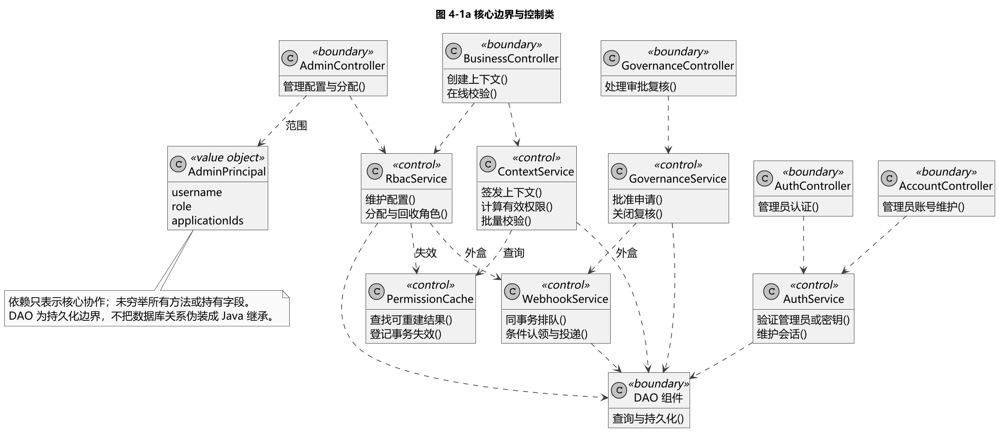

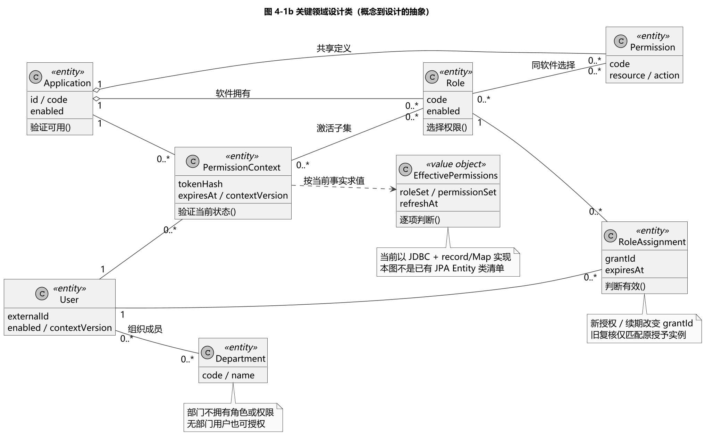

图例：boundary 表示交互边界，control 表示业务控制，entity 表示设计层领域对象，value object 表示值对象。图 4-1b 的实体是从现有数据与业务语义抽象出的设计对象，当前实现主要通过 record/Map 和 JDBC 表达，未声称源码存在同名 JPA Entity。图中不列外键字段。实线表示关联及多重性，空心菱形表示聚合，虚线表示依赖。本模型无角色继承，也没有可成立的业务泛化关系，因此不人为添加继承。

表 4-1 核心类职责及转换依据

| 类或设计对象 | 职责与关键业务操作 | 分析来源与需求 |
| --- | --- | --- |
| AdminController / BusinessController / GovernanceController | 分别提供配置、可信业务授权、治理 HTTP 边界；校验操作范围 | 原 UC05–UC10、UC12–UC14；CF03–CF12 |
| AuthController / AccountController | 管理员登录与管理员账号维护；控制台与业务用户身份分离 | 原 UC01、UC02 校正；CF01、CF05 |
| RbacService | 软件配置、用户角色分配、期限与事务协调 | 原 Role/用户角色分配；CF02–CF06 |
| ContextService | 上下文签发、有效集计算、逐项校验和注销 | 原 LoginSession 的授权部分校正；CF07、CF08 |
| GovernanceService | 申请审批、复核快照和清单转换 | 当前扩展；CF09、CF10 |
| WebhookService / WebhookDelivery | 可靠事件排队与投递生命周期 | 当前扩展；CF11 |
| RoleAssignment | 用户显式角色关系、有效期和授予实例；判断分配有效 | 原用户角色分配；CF06、CF09 |
| PermissionContext / EffectivePermissions | 维护当前软件激活集合、有效性及最早到期；只输出可授权结果 | 原上下文/AuthVersion 校正；CF07、CF08 |
| AdminPrincipal | 已认证管理员身份、角色与软件可见集合 | 原 ManagementScope 校正；CF05 |

### 4.2 关键类状态设计

选择 WebhookDelivery，因为它包含认领、超时、失败、重试、租约恢复和陈旧结果拒绝，比单纯启停对象具有更复杂的生命周期。原图4-6 的 LoginSession 状态模型作为状态建模来源，但不照搬其部门切换语义。图 4-2 的状态与 WebhookDao、WebhookService 一致。

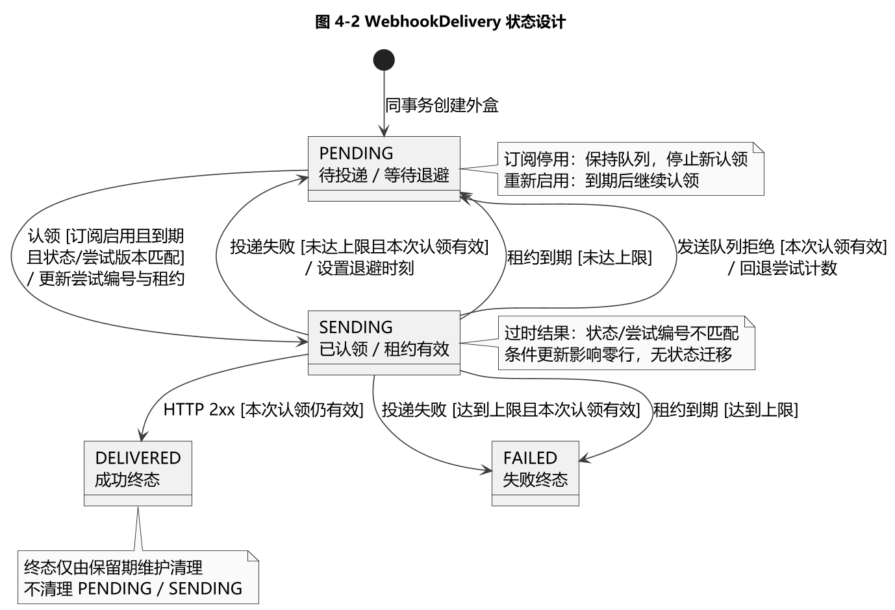

表 4-2 状态与关键迁移约束

| 状态或事件 | 守卫与响应 |
| --- | --- |
| PENDING | 同事务创建；仅订阅启用、到达重试时刻且认领时尝试版本一致，才能进入 SENDING |
| SENDING | 当前认领持有租约与尝试编号；投递成功进入 DELIVERED；失败且未达上限回到 PENDING；达上限进入 FAILED |
| 租约过期 | 仍未达最大次数则回队；最后一次认领过期直接 FAILED，不能无限恢复重试 |
| 发送队列拒绝 | 只有本次认领仍有效时回退为 PENDING，并撤回本次尝试计数 |
| 过时线程写回 | 状态/尝试编号不匹配则不产生迁移，不能覆盖新认领结果 |
| DELIVERED / FAILED | 终态，保留供查询；保留期任务仅清理终态，不清除待投递或发送中记录 |
| 订阅停用 | 不新认领；已排队记录保留，重新启用后可继续，不生成额外“停用投递”状态 |

### 4.3 系统级数据流图

本文“顶层”表示整个系统的上下文图，“第一层”表示将整个系统分解为 P1–P6。它们对应原需求图4-7 和图4-8 的层次；原图4-9 的 P4 内部分解不在本次继续展开。数据流以信息内容命名，不把控制调用顺序当作数据流。

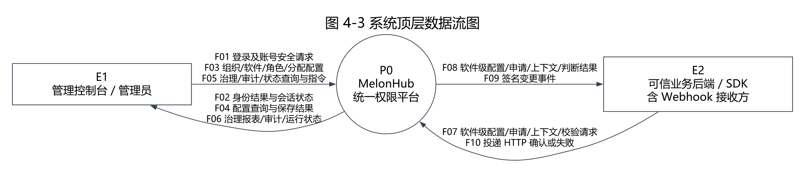

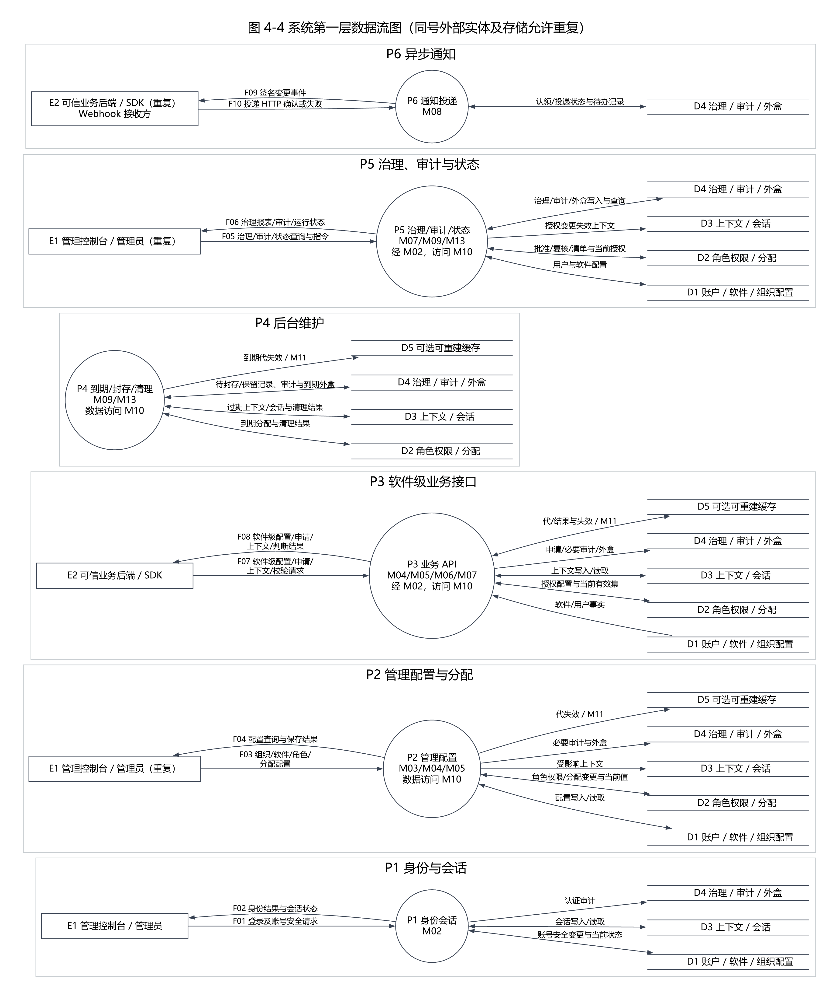

图 4-3、图 4-4 均保留 E1 管理控制台/管理员和 E2 可信业务后端/SDK 两类外部实体；E2 同时作为授权 API 调用方和 Webhook 接收方。当前没有 HR/OA 专用协议实现，不能为满足原图照抄虚构接口。第一层 D1 为账户/软件/组织配置，D2 为角色权限/分配，D3 为上下文/会话，D4 为治理/审计/外盒，D5 为可选可重建缓存。

表 4-3 父子平衡与数据流到模块映射

| 流编号与方向 | 两层相同的数据流 | 第一层加工及模块 |
| --- | --- | --- |
| F01 E1 → 系统 | 登录及账号安全请求 | P1：M02 |
| F02 系统 → E1 | 身份结果与会话状态 | P1：M02 |
| F03 E1 → 系统 | 组织/软件/角色/分配配置 | P2：M03、M04、M05 |
| F04 系统 → E1 | 配置查询与保存结果 | P2：M03、M04、M05 |
| F05 E1 → 系统 | 治理/审计/状态查询与指令 | P5：M07、M09、M13 |
| F06 系统 → E1 | 治理报表/审计/运行状态 | P5：M07、M09、M13 |
| F07 E2 → 系统 | 软件级配置/申请/上下文/校验请求 | P3：M04、M05、M06、M07；经 M02 |
| F08 系统 → E2 | 软件级配置/申请/上下文/判断结果 | P3：M04、M05、M06、M07 |
| F09 系统 → E2 | 签名变更事件 | P6：M08 |
| F10 E2 → 系统 | 投递 HTTP 确认或失败 | P6：M08 |

P4 为后台到期、封存与清理，映射 M09/M13，经 M10 处理持久数据，并在影响授权时协调 M11。P2/P3/P5 在各自业务边界中访问授权数据并保存必要审计/外盒，P6 读取待办投递。图 4-4 分区排列同一层加工，为避免交叉线重复绘制 E1/E2 和 D1–D5；同号对象是同一逻辑实体或存储，并非多个副本或新数据库。双向箭头概括标注的读/写数据类别。内部存储流不改变表 4-3 的十条外部边界流，两层均未新增业务执行结果或 HR 审批数据。

### 4.4 关键运行时设计

三张时序图仅以模块/组件为生命线。关键交互回到 ST、U 和 AD，详细算法及类方法调用不展开。

图 4-5 对应 ST01/ST02、U1/U2、AD03/AD05/AD06：可信业务后端逐操作发起校验，先辨认软件与限流，再核验上下文所属和有效性；可选缓存不确定时读取 MySQL。客户端拿到允许结论后执行业务，平台异常按拒绝处理。

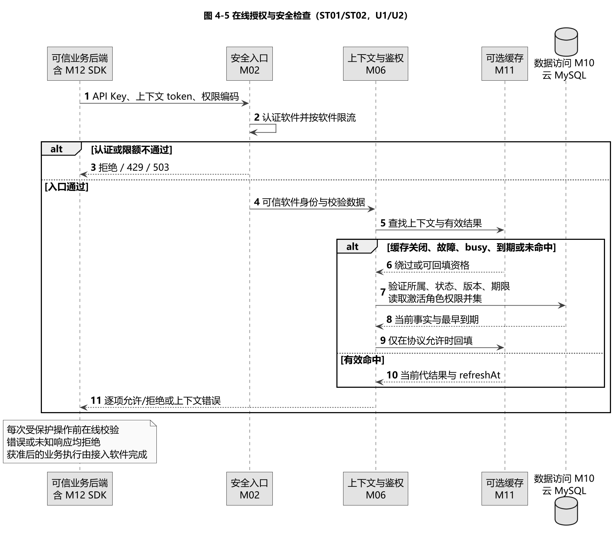

图 4-6 对应 ST03、U3、AD04/AD05：授权写入在同事务内保存分配、审计和外盒；启用缓存时提交前后协调代标记；提交后的新校验读取新状态。分配到期直接排除，不等待维护任务。缓存关闭时跳过缓存协作，但保留事务和 MySQL 求值。

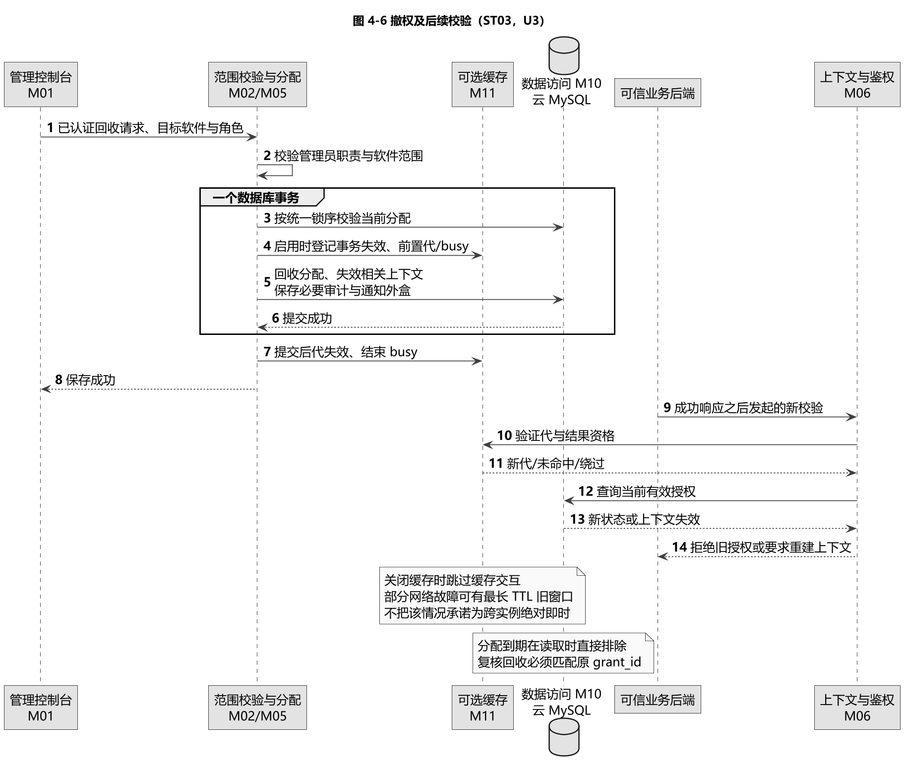

图 4-7 对应 ST04、U4、AD07：独立发送池从外盒条件认领，HTTP 成功后按认领版本写回；超时回队或最终失败，崩溃留下的 SENDING 等待租约恢复。至少一次尝试可能重复到达，接收方按事件标识去重。

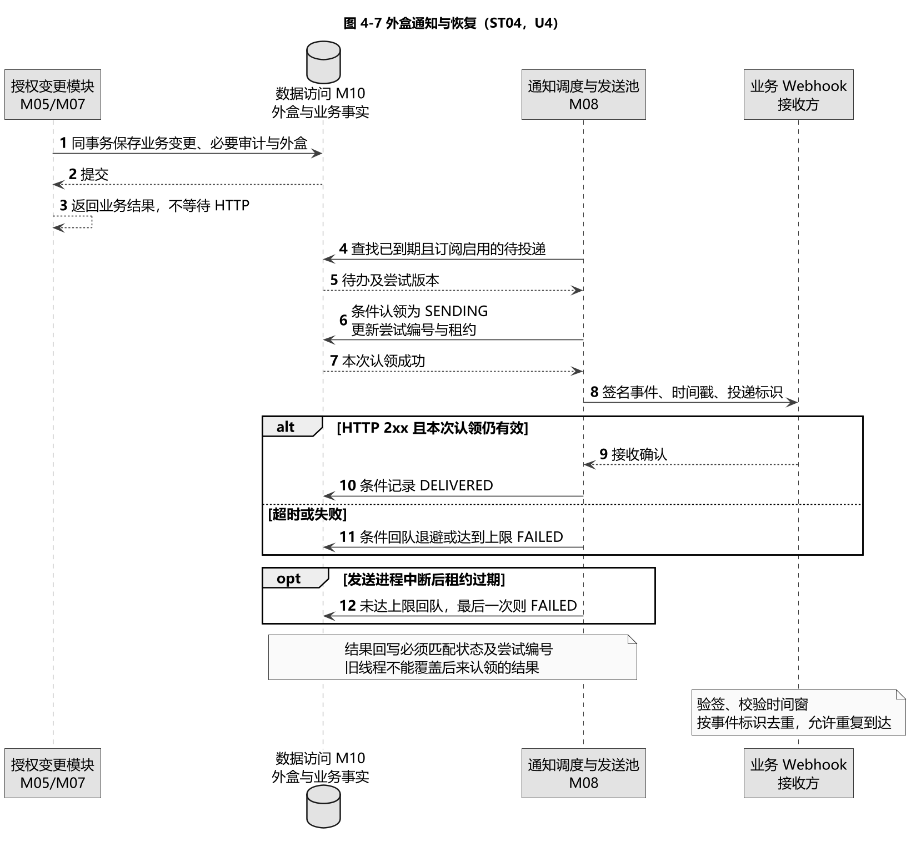

## 5 接口设计

### 5.1 外部接口

#### 5.1.1 用户界面接口

EXT01 为管理员与 Web 控制台的交互界面，使用键盘、鼠标、触摸与屏幕；采用列表、分页、搜索、抽屉及确认对话框，适配桌面/手机和明暗主题。软件为授权配置范围，部门用于人员筛选。敏感操作显示目标和影响范围，表单校验不替代后端范围校验。对应 CF13、CN05；M01/M02；API01–API12。

业务用户界面位于接入软件，平台不提供业务用户登录页面。接入方可根据有效权限集控制菜单，但必须在后端受保护操作前再次校验，不能把前端权限集当作长期允许凭据。

#### 5.1.2 硬件与第三方软件接口

表 5-1 外部连接契约

| 编号 | 两端与用途 | 协议与数据大类 | 约束及需求 |
| --- | --- | --- | --- |
| EXT02 | 可信业务后端/Java SDK ↔ 平台 | HTTP/JSON；API Key、上下文 token、授权请求/结论 | API Key 不进入普通浏览器；externalId 来自业务认证；CF03、CF07、CF08、CF13；CN01、CN04 |
| EXT03 | 平台 → Webhook 接收方 | HTTP POST/JSON、HMAC-SHA256；事件标识、时间戳、变更摘要 | 可达部署优先 HTTPS；当前仅校验 http(s) URL；验签、时间窗和幂等去重；CF11；CN04、CN07 |
| EXT04 | 运行管理员 ↔ 服务器后端 | SSH 加密通道、受控容器运维、健康探测 | 当前入口绑定回环；凭据外置，主机密钥校验；CF12；CN04、CN06 |
| EXT05 | 管理员验证器 ↔ 管理员认证 | TOTP 动态口令，通过控制台提交；不依赖外部身份提供商 | 使用时间步及防重放，绑定确认后启用；CF01；CN07 |

专用硬件接口：本章节不适用，原因：平台只依赖通用计算设备与网络，不连接读卡器或生物识别设备。HR/OA/SSO 软件接口：当前无专用实现，既有用户导入与可信后端 API 不等同于已完成 HR 同步或企业单点登录。

### 5.2 内部系统级 API 契约

这里的“内部”指平台控制台、业务接入方与后端之间的系统级对接。表 5-2 按用途归纳实际路径族，避免复制全部详细 API。`/api/admin` 使用管理员 Bearer 会话；`/api/v1` 使用 X-API-Key，指定上下文操作另带 X-Context-Token。受保护路径默认拒绝；健康及登录公开。

表 5-2 HTTP 接口族

| 编号与名称 | 谁与谁通信、主要路径 | 核心输入 → 核心返回 | 协议与需求 |
| --- | --- | --- | --- |
| API01 管理员会话与安全 | M01 → M02；POST `/api/auth/login`、GET `/api/auth/me`、POST `/api/auth/logout`、`/api/auth/password`、`/api/auth/mfa/*` | 账号/密码/动态口令或会话 → 身份、一次性 token、安全操作结果 | HTTP/JSON；CF01、CN07 |
| API02 管理员账号 | M01 → M02；`/api/admin/accounts` 及账号子资源 | 账号资料、角色、软件集合 → 账号视图/执行结果 | HTTP/JSON；仅超级管理员；CF05 |
| API03 组织与用户 | M01 → M03；`/api/admin/departments`、`/api/admin/users`、用户 contexts/access | 资料、成员、状态、分页 → 用户/部门/访问摘要/撤销结果 | HTTP/JSON；CF02、CF06 |
| API04 软件与密钥 | M01 → M04；`/api/admin/applications`、软件 status、keys、rotate-key | 软件资料、密钥策略 → 软件视图/仅创建时密钥原文 | HTTP/JSON；CF03 |
| API05 RBAC 配置 | M01 → M04；`/api/admin/roles`、`/permissions`、角色 permissions；E2 对应 `/api/v1/roles`、`/permissions` | 软件范围、角色/权限定义、关联集合 → 配置视图/标识 | HTTP/JSON；CF04、CN01 |
| API06 分配与模拟 | M01 → M05；`/api/admin/users/{id}/roles`、`/roles/{id}/members`、`/assignments/batch`、`/assignments`、`/simulate`；E2 可用 `/api/v1/users/{id}/roles` | 用户/角色集合、期限或模拟条件 → 分配视图/批量结果/模拟结论 | HTTP/JSON；CF06、CN02 |
| API07 上下文与在线鉴权 | E2 → M06；POST/DELETE `/api/v1/contexts`、GET `/contexts/effective`、POST `/contexts/check`、GET `/users/access` | externalId/激活角色或 token/权限编码 → 上下文/有效集/逐项布尔结论 | HTTP/JSON；CF07、CF08 |
| API08 角色申请审批 | E2/M01 → M07；`/api/v1/access-requests`、申请 cancel；`/api/admin/access-requests`、approve/reject | 用户、角色、理由、期限/审批决定 → 申请状态与授予结果 | HTTP/JSON；CF09 |
| API09 权限复核 | M01 → M07；`/api/admin/reviews`、items、close | 软件、人员筛选、复核决定 → 快照、回收/跳过结果 | HTTP/JSON；CF09、CN08 |
| API10 导入与查询 | M01 → M07；`/api/admin/manifest`、manifest/import、users/import、permissions/who、assignments/expiring、search、overview、软件 rate-limit | v3 清单、用户行、筛选/限额 → 导入逐项结果、受限报表/概要 | HTTP/JSON；CF10、CN03、CN05 |
| API11 通知管理与投递 | M01 → M08；软件 webhooks、`/api/admin/webhooks/{id}`、deliveries/test；M08 → EXT03 登记地址 | 订阅、事件配置/签名事件 → 登记结果/投递状态/HTTP 确认 | HTTP/JSON；CF11、CN04 |
| API12 审计与运行状态 | M01/监测 → M09/M13；`/api/admin/audit`、audit/export、audit/verify、system/status、GET `/api/health`；独立监测端 `/actuator/*` | 筛选、链序号、健康请求 → 可见审计、链校验/运行状态 | HTTP/JSON；Actuator 仅受控回环；CF12 |

第 3.3 节的 INT01–INT06 是进程内契约：依赖注入共享服务，事务由 Service 边界组织；没有另设 RPC 或消息中间件。数据库连接为 JDBC/TLS，Redis 为可选 RESP/Lua 连接，具体参数属于详细设计与部署配置。

### 5.3 通用规约与错误边界

接口 JSON 字段与详细路由以 REF05 为准；本节不贴请求样例和函数签名。时间采用带时区格式；响应带 X-Request-Id，安全响应头和 no-store。分页给出记录、总数、页号与页大小，普通分页受上限约束。集合 PUT 为整体替换，空集合清空；批量追加是单独接口，不能混淆语义。一次权限检查最多 100 个编码；全部允许时聚合结论才为允许。

表 5-3 错误与处理约定

| 情况 | 对外结果类别 | 调用方责任 |
| --- | --- | --- |
| 参数/路径不规范 | 400；类型不符等可返回对应 4xx | 修正请求；不按业务成功处理 |
| 未认证/凭据失效 | 401 | 管理员重新登录；业务方按上下文错误重建或更换凭据 |
| 越权/不存在 | 403/404，按实际契约隐藏无权对象 | 不扩大范围、不替换他人标识绕过 |
| 状态或并发冲突 | 409 或明确业务错误 | 重新读取状态后由用户处理，不假称通用幂等自动重放 |
| 超限/资源繁忙 | 429/503，必要时 Retry-After | 退避、限制重试，受保护操作保持拒绝 |
| 网络、数据库或未知错误 | 5xx/超时，响应不含堆栈 | 失败关闭；不得沿用旧允许结果 |

Java SDK 可在上下文失效后重建一次，对 429/503 作有限退避；不缓存允许结论跨多次受保护操作。原需求的通用幂等请求表与覆盖式写入预期版本契约没有在当前接口中实现，不能在此新增承诺。

## 6 数据设计与存储策略

### 6.1 全局逻辑数据结构

图 6-1 为授权核心高级 ER 图，图 6-2 为治理、安全及通知审计视图；仅列全局关联，不把第 4 节设计类当作数据库表。两图通过 users、applications 等共享实体衔接。

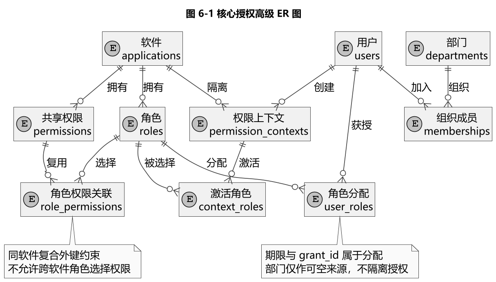

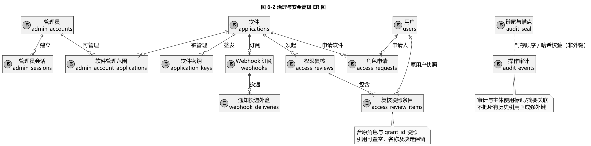

实体关系约束：角色和权限分别归属一个软件，同软件多对多关联；用户与部门多对多，仅为组织关系；用户与角色通过有期限、grant_id 的分配关联；上下文关联一个用户和一个软件，并选择激活角色。管理员会话是独立安全体系，软件 API Key 不等于用户凭据。治理快照删除引用时可置空但保留名称和决定，避免历史因主体删除而消失。

### 6.2 概要级表结构

表 6-1 主要运行表及关键字段。仅列概要字段与键，完整结构留在数据库详细设计。

| 表名 | 关键字段节选 | 主键/外键与重要约束 |
| --- | --- | --- |
| applications | id、code、name、enabled、rate_limit | PK id；软件编码唯一 |
| users | id、external_id、name、enabled、context_version | PK id；external_id 唯一 |
| departments / memberships | 部门 id、code；user_id、department_id | 部门 PK id；成员联合 PK；分别引用用户/部门 |
| roles | id、application_id、code、enabled | PK id；软件 FK；软件内 code 唯一 |
| permissions | id、application_id、code、resource、action | PK id；软件 FK；软件内 code 唯一；没有 role_id |
| role_permissions | role_id、permission_id、application_id | 联合 PK；两组复合 FK 保证同软件 |
| user_roles | user_id、role_id、application_id、expires_at、grant_id | 用户/角色联合 PK；用户 FK、角色/软件复合 FK；department_id 仅为可空来源 |
| permission_contexts | id、user_id、application_id、context_version、expires_at | PK 为 token 哈希；用户/软件 FK；部门可空，不参与授权隔离 |
| context_roles | context_id、role_id | 联合 PK，引用上下文与角色 |
| application_keys | id、application_id、key_hash、expires_at、revoked_at | PK id；软件 FK；密钥哈希唯一；有效密钥数由软件行锁保护 |
| admin_accounts / admin_sessions | 账号 username、role、credential_version；会话 token_hash、expires_at | 账号 PK username；会话 PK token_hash，username FK；会话带凭据版本 |
| admin_account_applications | username、application_id | 联合 PK，引用管理员和软件 |
| access_requests | id、user_id、role_id、application_id、status、pending_role_id | PK id；同用户同待审批角色唯一；主体引用可空且保留名称快照 |
| access_reviews / access_review_items | 复核 id、application_id、status；条目 id、review_id、grant_id、decision、skipped | 各 PK id；条目 FK 指向复核；保留用户/角色快照及原授予实例 |
| webhooks / webhook_deliveries | 订阅 id、application_id、events；投递 id、event_id、status、attempts、next_attempt_at | 各 PK id；软件/订阅 FK；事件标识用于去重；结果更新带状态与尝试条件 |
| audit_events / audit_seal | 事件 id、application_id、actor、seal_seq、chain_hash；封存 id、last_seq、anchor_seq | 各 PK id；封存状态单行协调；按封存顺序串链，不以事件 ID 代替提交顺序 |

迁移归档另有 role_migration_archive、permission_migration_archive、permission_merge_archive，仅用于历史追溯，不参与在线授权；Flyway 自身维护迁移历史。表 6-1 中合并展示的表在数据库仍独立，运行表共 21 张，另有三张归档表和一张 Flyway 管理表。

### 6.3 存储技术、拓扑与一致性

表 6-2 数据策略及需求

| 编号 | 方案与理由 | 一致性或边界 | 需求 |
| --- | --- | --- | --- |
| DS01 关系持久化 | 云 MySQL 唯一事实源，保存配置、分配、会话、治理、外盒和审计；事务适合关联约束 | 当前单逻辑写入口，无已验收读写分离、分片或复制容灾；授权不读延迟副本 | CF01–CF12；CN02、CN04、CN08 |
| DS02 标识与同软件约束 | 业务表主要用数据库 ID，稳定编码唯一；token 用随机值的 SHA-256，grant/event 使用稳定实例标识 | 不引入独立全局 ID 服务；软件内唯一键和复合 FK 是最终兜底 | CF03、CF04、CF06、CF09；CN01、CN08 |
| DS03 可选可重建缓存 | Redis 只存上下文元信息、有效权限/密钥状态、代标记、限流计数 | 默认关闭；结果最长 60 秒且不晚于最早分配到期；命中也检查 refreshAt | CF03、CF07、CF08；CN02、CN03 |
| DS04 失效与故障恢复 | 事务内登记用户/软件/密钥变化，提交前后改变代标记，busy 阻止不安全回填；遗漏失效恢复时推进 epoch | 单节点 Lua 协议；部分网络故障可有最长结果 TTL 旧窗口；失败回源 MySQL | CF06–CF09；CN02、CN04 |
| DS05 事务与并发 | 统一用户→角色→分配锁序，批量按 ID；成员替换冲突整次回滚有限重试；审批条件转换、复核比对 grant_id | 关系/版本/审计/外盒失败导致写事务失败；没有通用写入请求幂等协议 | CF06、CF09、CF11；CN02、CN08 |
| DS06 审计与外盒 | 同库操作记录、异步封存链及外盒投递，名称快照与授予标识保留历史 | 不记录每次鉴权；终态可清理；同库链不能替代外部存证 | CF09、CF11、CF12；CN04、CN07 |
| DS07 凭据保护 | 密码 BCrypt；API Key、会话和上下文仅存哈希；签名/TOTP 密钥需参与计算 | 后两类密钥目前原文存库，备份与数据库权限需按敏感级别保护 | CF01、CF03、CF11；CN07 |
| DS08 迁移与恢复 | 正式/测试库隔离，云入口与 TLS 启动保护；Flyway 追加迁移；保留期分批清理 | MySQL DDL 回滚有限，发布回退不等于数据库回退；备份及恢复演练待环境验收 | CF12；CN04、CN06、CN08 |

无对象存储需求：本章节中对象存储方案不适用，原因是平台无图片、视频或大附件持久业务；源码、运行包和文档属于构建交付，不作为授权数据另建 OSS。

高并发下不采用“简单 TTL 等待撤权”。缓存写前读取代和 busy，只有安全时回填；旧数据库快照只能写入旧代键，正常提交后新读计算新键。到期属时间事件，无写事务也应立即排除角色。Redis 不可用时授权缓存与全局限流分别熔断；限流回到实例内预算，多实例总体额度不再等于单一全局限额。

## 7 部署设计

### 7.1 部署图

图 7-1 描述当前文档与脚本所示的服务器后端、本机前端和 SSH 通道，不包含真实主机地址或凭据。Redis 作为待部署可选节点；公开 HTTPS 网关和负载均衡仅为将来接入规划，没有画成已上线节点。

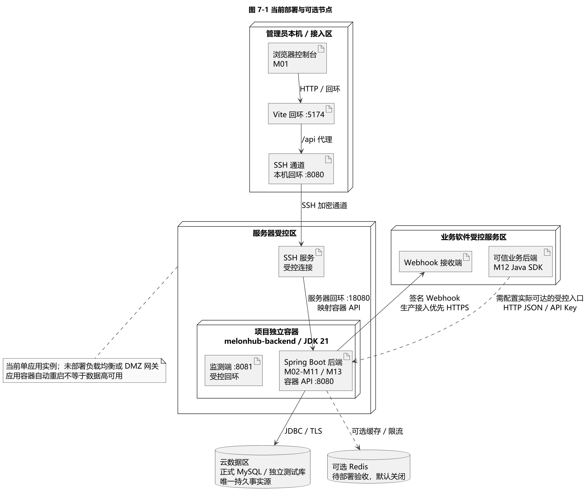

### 7.2 物理拓扑与网络边界

表 7-1 节点与逻辑组件映射

| 节点或区域 | 部署制品和职责 | 网络与访问限制 |
| --- | --- | --- |
| 管理员本机 | 浏览器、Vite 控制台 M01、SSH 客户端；开发/演示入口 | 前端回环 5174，经本机回环 8080 通道转发；不向局域网直接开放 |
| 服务器受控区 | melonhub-backend 独立容器，JDK 21；M02–M11/M13 | 服务器回环 18080 映射容器 API 8080；通过 SSH 或另行受控入口访问；容器可自动重启 |
| 数据持久区 | 云 MySQL 正式库；独立云测试库 | JDBC/TLS，凭据分离、固定 schema；应用不能误连任意本地数据源 |
| 可选缓存区 | Redis 缓存/全局限流 | 当前未启用；启用前限制网络访问并做协议验收，不能把单节点 Lua 当作 Redis Cluster 支持 |
| 外部业务软件区 | 可信业务后端与 M12 SDK，业务本体与 Webhook 接收器 | 需配置实际可达的受控入口；普通浏览器不持有 API Key；通知优先 HTTPS 并验签 |
| 监测与运维边界 | 健康、Actuator、部署管理 | Actuator 只绑定受控回环，不直接暴露到外网；真实配置存忽略文件 |

当前没有独立 DMZ 网关、负载均衡器、MySQL 读副本或多活中心。公司统一入口需要公开访问时，应先完成 HTTPS、来源控制与可达性设计，不能直接把回环 API 对外发布。采用“接入区—应用受控区—数据区”的逻辑隔离描述，不把它误称为已实施的物理 VLAN/DMZ。

BACKEND_MODE=server 为日常方式，本机停止只停止前端与隧道，不停止服务器后端；local 仅表示本机 Java 调试，仍连接云数据库。应用运行包、配置和数据库生命周期分离；后端回滚不自动回滚已执行的数据库迁移。Java SDK 位于业务软件进程，与后端容器独立构建。

### 7.3 扩展、恢复与容量说明

应用会话与授权事实保存于 MySQL，可作为多实例演进基础；但扩容前必须验证共享缓存/限流、后台条件认领、数据库连接总预算和实例故障恢复。当前不宣称有负载均衡或无状态 HA 已验收。容器重启提升进程可恢复性，不能替代数据库备份及全链路恢复演练。

机器资源和部署连接参数属于具体环境配置，本设计不下发脚本。4 核 8GB、1 万用户、200 请求/秒仅用于 ST01 建议验收环境；当前云数据库网络时延与 Redis 关闭状态均需纳入容量测试。

## 8 非功能需求实现方案

表 8-1 逐条质量需求落实

| 编号与质量 | 体系结构及模块落实 | 数据/部署落实 | 对应故事与验证方向 |
| --- | --- | --- | --- |
| CN01 安全隔离 | AD02/AD03，M02 认证后逐对象软件所属校验；M12 不接受未经认证的外部用户头 | DS02 同软件复合 FK；API Key 固定软件，真实凭据不入浏览器 | ST02；同名权限跨软件反例、四类管理员范围、绕过 UI 的直接请求 |
| CN02 一致性 | AD04/AD05/AD07；M05/M07 事务，M06 求值，M11 失效；复核按 grant_id | DS01/DS04/DS05，同事务审计/外盒；不读延迟副本 | ST03；提交后读、到期、续期复核、旧回填、部分 Redis 故障窗口 |
| CN03 性能 | AD05/AD06；有限资源、软件限流、授权读无行锁、异步通知 | DS03 缓存可重建；数据库连接总预算；当前云链路待压测 | ST01；分别测关闭/启用缓存及超额流量，报告成功、拒绝与错误分布 |
| CN04 可靠与恢复 | AD05/AD07/AD09/AD10；熔断回源、失败关闭、外盒租约、优雅停机 | DS01/DS06/DS08；独立运行包、数据备份和恢复演练；当前单点明确 | ST04；超时、发送中断、重复、租约终态、数据库失败与恢复后撤权核验 |
| CN05 易用性 | AD10；M01 目标确认、软件范围、手机与主题，丢弃过期响应 | 不把本地选择当服务端授权；局部范围复用既有组件规则 | ST05；快速切换软件/搜索/关闭抽屉、375px 与桌面视图 |
| CN06 可维护/可移植 | AD01/AD09/AD10；职责分层，SDK 独立；接口版本与 v3 清单 | DS08 Flyway 追加；外置环境配置；Java 17 目标/服务器 21、浏览器标准技术 | ST05；新增软件不改平台源码，v1/v2 明确拒绝；不声称任意数据库兼容 |
| CN07 保密与审计 | AD03/AD08；M02 哈希、口令与凭据版本，M09 封存；响应不含内部异常 | DS06/DS07，TOTP/Webhook 密钥保护边界和同库链局限 | ST02/ST04；凭据回显/日志检查、会话撤销、口令重放、审计链修改检测 |
| CN08 数据完整 | AD02/AD04/AD09；M10 唯一键、复合 FK、条件转换与 grant_id | DS02/DS05/DS08，正式测试隔离、迁移归档、稳定标识 | ST03/ST05；跨软件关联拒绝、并发审批、旧复核跳过、迁移后授权不增不减 |

### 8.1 保证与证据界限

表 8-1 是设计及验证分配，不是本次运行测试报告。已有后端、SDK、前端测试入口见 REF07；历史本地压测不能代替当前云链路，Redis 相关跳过用例不能当作通过。本文编写未运行生产迁移、未部署服务、未连接真实数据核查当前内容。

建议的 99.9% 可用性、RPO 24 小时、RTO 4 小时沿用原需求的待确认性质；当前无本轮恢复演练证据。审计默认保留期与管理员空闲超时属于外置运行配置，不作为不可调整的业务常量。当前不审计每次授权读取或日志查询本身，故不能沿用原 NFR11 的全调用留痕表述。

## 9 需求可追溯性矩阵

### 9.1 原需求编号对照

本表严格保留原文编号；“校正”表示采用代码基线后的含义不同。原用例 UC01–UC15 与同号 FR 一一对应，引用只表示来源。表中不以替代设计虚报原要求已覆盖。

表 9-1 原功能需求对照

| 原需求 / 用例 | 原名称 | 代码基线对应 | 处理结论 |
| --- | --- | --- | --- |
| FR01 / UC01 | 登录应用会话 | CF01 | 校正：控制台管理员登录，业务用户由外部软件认证 |
| FR02 / UC02 | 退出应用会话 | CF01、CF07 | 校正：管理员退出与业务上下文注销分开 |
| FR03 / UC03 | 导入或建立用户 | CF02、CF10 | 保留本地维护/导入；无 HR 自动同步协议 |
| FR04 / UC04 | 归属与人员状态 | CF02 | 校正：多部门组织关系、无部门可授权，调岗不自动撤权 |
| FR05 / UC05 | 接入应用 | CF03 | 保留并增加多 API Key |
| FR06 / UC06 | 定义权限项 | CF04 | 校正：软件内共享定义，无独立权限启停字段 |
| FR07 / UC07 | 角色及权限 | CF04 | 校正：同软件关联，取消部门权限域 |
| FR08 / UC08 | 管理范围 | CF05 | 校正：固定四类管理员及软件集合，无动态可授角色范围 |
| FR09 / UC09 | 显式授予角色 | CF06 | 校正：软件级分配，含期限与批量追加 |
| FR10 / UC10 | 撤销选定/全部授权 | CF06 | 软件内回收；没有原定义的跨应用调岗全部回收协议 |
| FR11 / UC11 | 切换部门上下文 | CF07 | 原功能不采用；旧部门字段兼容，部门变化不撤销软件上下文 |
| FR12 / UC12 | 有效权限集查询 | CF07、CF08 | 保留，改为软件级且非登录凭证 |
| FR13 / UC13 | 后端权限判断 | CF08、CF13 | 保留在线默认拒绝，软件级批量判断 |
| FR14 / UC14 | 日志查询 | CF12 | 保留软件可见范围、导出和链校验；查询自身不强制留痕 |
| FR15 / UC15 | 配置空闲超时 | CF01 | 运行配置提供管理员空闲超时；没有 UI 应用级会话策略接口 |

表 9-2 原非功能要求对照

| 原编号 | 校正需求 | 差异与实现边界 |
| --- | --- | --- |
| NFR01 | CN01 | 隔离边界调整为软件，不承诺部门权限域 |
| NFR02 | CN01、CN07 | 默认拒绝和凭据保护保留；签名/TOTP 密钥参与计算而原文存库 |
| NFR03 | CN01、CN05 | 控制台/API 服务端共同校验；管理员制度与原动态权限模型不同 |
| NFR04 | CN02 | 正常协议保证边界保留；Redis 部分网络故障最长结果 TTL 窗口单列 |
| NFR05 | CN02、CN08 | 事务、条件并发与 grant_id；通用写请求幂等/预期版本未实现 |
| NFR06 | CN02、CN04 | 不能确定授权则失败关闭；不承诺撤回外部已执行业务 |
| 原 3.2.3 性能建议 | CN03 | 无独立原编号；ST01 使用建议数据集和指标，待验收 |
| NFR07 | CN04 | 缓存回源与数据库错误失败关闭 |
| NFR08 | CN04 | 备份恢复方向保留，正式 SLA/RPO/RTO 待确认和演练 |
| NFR09 | CN05 | 当前软件为授权范围，部门仅筛选；前端控制不代替后端 |
| NFR10 | CN06 | 配置化软件接入、API/v3 清单、Flyway 迁移；兼容周期未承诺 |
| NFR11 | CN07 | 记录重要操作与变更，不记录每次鉴权或日志查询 |
| NFR12 | CN08、CN07 | 稳定标识、软件内唯一性、引用完整、配置化保留期 |

### 9.2 校正需求到设计的完整矩阵

表 9-3 需求到故事、决策、模块、接口及数据实体

| 需求编号 | 需求名称 | 架构故事/决策 | 设计模块/类 | 内部/外部接口 | 全局数据实体与策略 |
| --- | --- | --- | --- | --- | --- |
| CF01 | 管理员认证与会话 | ST02；AD03、AD08 | M01/M02；AuthService | API01/02、INT01/02/06、EXT01/05 | AdminAccount/Session；DS01/07/08 |
| CF02 | 组织与用户 | ST05；AD01、AD02 | M03/M10；RbacService | API03、INT01/02/06、EXT01 | User/Department/Membership；DS01/02 |
| CF03 | 软件与密钥 | ST02；AD02/03/06/08 | M02/M04；AuthService | API04、INT01/02/03/04/06、EXT02 | Application/ApiKey；DS01/02/07 |
| CF04 | 软件级角色共享权限 | ST02/05；AD01/02 | M04/M10；RbacService | API05、INT01/02/03/05/06、EXT01/02 | Role/Permission/RolePermission；DS01/02/04 |
| CF05 | 管理员及软件范围 | ST02；AD03/08 | M02；AdminAccess/Principal | API02、INT01/02/06、EXT01 | AdminAccount/Scope；DS01/07 |
| CF06 | 分配、期限与回收 | ST03；AD02/04/05 | M05/M10/M11；RoleAssignment | API03/06、INT01/02/03/05/06、EXT01/02 | UserRole/Context；DS01/02/04/05 |
| CF07 | 软件上下文 | ST01/03；AD03/05/10 | M06/M11/M12；ContextService | API07、INT01/02/04/06、EXT02 | PermissionContext/ContextRole；DS01/03/04 |
| CF08 | 在线权限检查 | ST01/02/03；AD02–06/10 | M02/M06/M11/M12 | API07、INT01/02/04、EXT02 | EffectivePermissions/Role/Permission；DS01/03/04 |
| CF09 | 申请审批与复核 | ST03；AD01/04/07 | M07/M10；GovernanceService | API08/09、INT01/02/03/05/06、EXT01/02 | AccessRequest/Review/ReviewItem；DS01/02/05/06 |
| CF10 | 清单导入与查询 | ST05；AD01/02/06 | M07；Governance/ConsoleService | API10、INT01/02/03/05/06、EXT01 | User/Role/Permission/Assignment；DS01/02/04 |
| CF11 | Webhook 通知 | ST04；AD07/08 | M08；WebhookService/Delivery | API11、INT02/05/06、EXT03 | Webhook/Delivery；DS01/05/06/07 |
| CF12 | 审计、维护、健康 | ST04；AD06/08/09 | M09/M13；AuditSeal/Maintenance | API12、INT01/02/03/05/06、EXT04 | AuditEvent/Seal、到期与保留对象；DS01/06/08 |
| CF13 | 控制台与 SDK | ST01/02/05；AD09/10 | M01/M12；Client/Authorizer | API01–12、EXT01/02/03 | Session/Context（不保存业务数据）；DS03/07 |
| CN01 | 安全隔离 | ST02；AD02/03/10 | M02/M04/M06/M12 | API01–10、INT01、EXT02 | Application/Scope/Role；DS02/07 |
| CN02 | 事务与一致性 | ST03；AD01/04/05/07 | M05/M06/M07/M08/M10/M11 | API06–09/11、INT02–06 | Assignment/Context/Delivery；DS01/04/05/06 |
| CN03 | 性能与容量 | ST01；AD05/06 | M02/M06/M11/M13 | API07/10/12、INT04、EXT02 | 缓存/限流计数、Application；DS03/04 |
| CN04 | 故障与恢复 | ST04；AD05/07/09/10 | M06/M08/M11/M12/M13 | API07/11/12、EXT02/03/04 | 持久事实/Delivery；DS01/04/06/08 |
| CN05 | 易用性 | ST05；AD10 | M01；范围与页面组件 | API03–12、EXT01 | 受限视图、选择状态（非授权事实）；DS02 |
| CN06 | 维护与移植 | ST05；AD01/09/10 | M01–M13；分层组件 | API01–12、INT01–06、EXT04 | 版本化配置/迁移历史；DS08 |
| CN07 | 凭据与审计 | ST02/04；AD03/08 | M02/M08/M09 | API01/02/04/11/12、INT06、EXT03/05 | 凭据/AuditEvent/Seal；DS06/07 |
| CN08 | 完整性与迁移 | ST03/05；AD02/04/09 | M04/M05/M07/M10/M13 | API03–10、INT02、EXT04 | 关系约束/grant_id/归档；DS02/05/08 |

表 9-3 对全部 13 个功能需求、8 个质量需求给出设计落点；反向覆盖见表 9-4。范围符号表示连续编号的完整集合，例如 API01–12 表示 API01 至 API12。

表 9-4 设计元素反向覆盖索引

| 设计元素集合 | 需求来源 | 核查位置 |
| --- | --- | --- |
| AD01–AD10 | CF01–CF13、CN01–CN08 的适用项 | 表 2-1 逐项列出 |
| ST01–ST05 / U1–U5 | CN03、CN01/07、CN02/08、CN04、CN05/06 | 表 2-2、表 2-3、图 2-2 |
| M01–M13 | CF01–CF13 及横切 CN | 表 3-1 逐项列出 |
| INT01–INT06 | INT01→CN01；INT02→CN02/08；INT03/04→CN02/03/04；INT05→CF11/CN02/04；INT06→CF12/CN07 | 表 3-2 及表 9-3 |
| API01–API12 | CF01、CF05、CF02、CF03、CF04、CF06、CF07/08、CF09、CF09、CF10、CF11、CF12 | 表 5-2 |
| EXT01–EXT05 | CF13/CN05、CF03/07/08/13、CF11、CF12、CF01 | 表 5-1 与第 5.1.1 节 |
| DS01–DS08 | CN02/04/08、CN01/08、CN02/03、CN02/04、CN02/08、CN04/07、CN07、CN04/06/08 | 表 6-2 逐项列出 |

### 9.3 大作业一分析模型编号清单

表 9-5 原图号与本次转换

| 原规格图号及名称 | 本次引用与转换 | 对应原用例/校正需求 |
| --- | --- | --- |
| 图4-1 统一权限系统概念类图 | 图 4-1a/b、图 6-1/2；移除部门权限域、增加软件共享权限和授予实例 | UC03–UC10/UC12–UC14；CF02–CF09 |
| 图4-2 业务流程泳道图 | 仅引用，运行协作改用图 4-5 至图 4-7；不重复绘制活动图 | UC05–UC13；CF03–CF11 |
| 图4-3 用例图管理视图 | 仅引用；原 FR01–FR15 对照见表 9-1 | UC03–UC10/UC14/UC15 |
| 图4-4 用例图运行视图 | 仅引用；取消部门切换授权语义、业务登录划归接入方 | UC01/UC02/UC11–UC13 |
| 图4-5 UC09 显式授予角色泳道活动图 | 仅引用；分配事务/通知协作见图 4-6/7 | UC09；CF06、CF11 |
| 图4-6 登录会话状态图 | 作为状态建模来源；本次选更复杂的 WebhookDelivery 图 4-2，不照搬原 LoginSession | UC01/UC02/UC11/UC15；CF01/CF07/CF11 |
| 图4-7 顶层上下文数据流图 | 图 4-3；移除未实现 HR/OA 专用连接，保留实际边界 | CF01–CF13 |
| 图4-8 数据流图0层系统分解 | 图 4-4；加工映射软件级模块，并增加外盒通知 | CF02–CF12 |
| 图4-9 数据流图1层P4分解 | 仅引用其分配/回收分解来源；本次系统级 DFD 到第一层截止 | UC09/UC10；CF06 |

## 附录 A 原模板完整章节目保留与填写

本附录使用概要设计常见六章模板标题，保持原有层级并给出本项目填写结果。课程正文九节为扩展展开，并不删除模板项。

### A.1 引言

#### A.1.1 编写目的

见第 1.1 节，向评阅、开发和接入人员提供总体设计及评估依据。

#### A.1.2 背景

见第 1.2 节，企业多个软件集中授权；代码基线软件级 RBAC0。

#### A.1.3 定义

见表 1-1，术语以软件、共享权限、上下文、授予实例为核心。

#### A.1.4 参考资料

见表 1-2；原规格、校正清单、源码、接口与运行文档均有来源。

### A.2 总体设计

#### A.2.1 需求规定

见第 1.5 节、校正需求清单与第 9 节，原要求差异不隐去。

#### A.2.2 运行环境

见第 1.6 节、第 7 节；浏览器控制台、JDK 21 服务器、云 MySQL 和可选 Redis。

#### A.2.3 基本设计概念和处理流程

见第 2.1 节与第 4.4 节，软件身份→范围验证→授权/事务→持久化→返回及异步通知；只展开模块协作。

#### A.2.4 结构

见图 2-1、图 3-1 与表 3-1。

#### A.2.5 功能需求与程序的关系

见表 3-1、表 9-3；“程序”对应现有组件和职责模块，不展开函数清单。

#### A.2.6 人工处理过程

管理员负责配置接入软件、分配与回收角色、处理申请和复核、轮换密钥及检查失败投递；运维负责恢复演练与失败告警处置。平台不自动执行人事调岗或外部业务。

#### A.2.7 尚未解决的问题

当前云链路容量、Redis 服务器启用验收、正式 SLA/恢复目标、Webhook 出站限制、密钥加密和外部审计存证仍待决策或验证，见表 2-5/6。

### A.3 接口设计

#### A.3.1 用户接口

见第 5.1.1 节；浏览器控制台，键鼠/触摸与屏幕，无专用硬件。

#### A.3.2 外部接口

见表 5-1；业务软件、签名通知、SSH 运维和 TOTP 验证器。

#### A.3.3 内部接口

见第 3.3 节、第 5.2 节；模块内调用和 HTTP 接口族分别定义。

### A.4 运行设计

#### A.4.1 运行模块组合

在线校验为 M02+M06+M10+可选 M11；管理变更为 M02+对应 M03–M07+M10+必要 M08/M09/M11；后台投递为 M08+M10，维护为 M09+M10；SDK M12 位于外部业务进程。

#### A.4.2 运行控制

HTTP 请求驱动在线流程；Spring 定时任务驱动到期、投递、封存与清理。写事务由业务层管理；投递独立线程池，条件认领和尝试版本控制多实例协作；控制台请求使用身份与当前软件范围。

#### A.4.3 运行时间

性能目标见 ST01，须以实际环境验收。上下文寿命一小时；结果缓存不超过最早分配到期；后台到期清理每分钟而授权到期即时排除。通知周期与退避不是用户请求同步等待时间，详见表 4-2 和 REF04。不把运行配置值当作响应时间保证。

### A.5 系统数据结构设计

#### A.5.1 逻辑结构设计要点

见第 6.1 节，软件—角色—共享权限、用户—分配、上下文及治理全局关系。

#### A.5.2 物理结构设计要点

见第 6.3 节、第 7 节，云 MySQL、可选 Redis 和正式/测试隔离，不给出建表语句或部署参数。

#### A.5.3 数据结构与程序的关系

M03/M04 管理用户组织和软件配置，M05 管理分配，M06 管理上下文，M07 管理治理，M08 管理外盒，M09 管理审计；统一通过 M10 访问，M11 只保存可重建结果，见表 9-3。

### A.6 系统出错处理设计

#### A.6.1 出错信息

见表 5-3；区分参数、认证、权限、对象、状态冲突、限流与服务繁忙，包含请求编号，不泄露堆栈和凭据。

#### A.6.2 补救措施

MySQL 事务失败回滚；授权错误失败关闭；缓存熔断回源；通知按上限重试并保留失败终态；SDK 有限重试。数据库恢复后核验授权与审计，不能自动恢复已经撤销的分配。

#### A.6.3 系统维护设计

健康与监控隔离，保留期分批清理，Flyway 追加迁移，真实凭据外置，更新先验证后发布。当前架构残余风险及改善计划见第 2.3.4 节与第 8.1 节。
